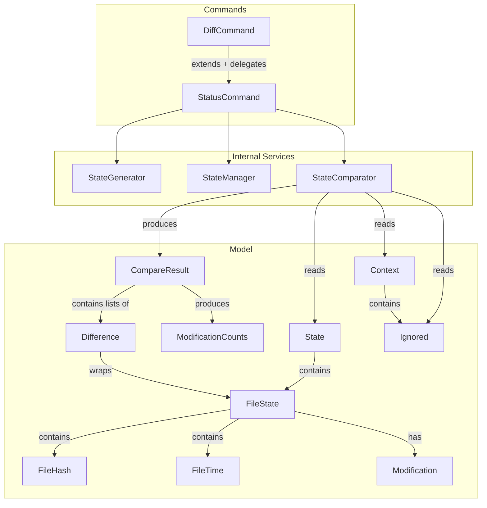
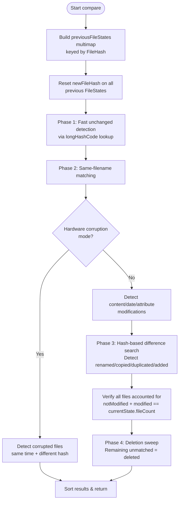

# Design Document: Change Detection

## Overview

This design documents the Change Detection subsystem of FIM (File Integrity Manager). Change Detection is the core comparison engine that identifies what has changed between a previously committed State and the current file tree. It encompasses:

- **Command layer**: `StatusCommand` (the primary user-facing command) and `DiffCommand` (a deprecated backward-compatible alias).
- **Comparison engine**: `StateComparator`, which implements a multi-phase pipeline that classifies every file into one of nine modification categories.
- **Result model**: `CompareResult`, `Difference`, `Modification`, and `ModificationCounts`, which structure and display the comparison output.

The comparison pipeline operates in four sequential phases:
1. **Fast unchanged detection** — uses `longHashCode()` (SHA-512-based) for O(1) lookup to quickly exclude identical files.
2. **Same-filename matching** — compares files with matching names to detect content, date, and attribute modifications (or corruption in hardware-corruption mode).
3. **Hash-based difference search** — matches remaining files by `FileHash` to detect renames, copies, and duplicates.
4. **Deletion sweep** — classifies any unmatched previous files as deleted (excluding ignored files).

## Architecture



### Comparison Pipeline Detail



### Key Design Decisions

1. **longHashCode for fast equality**: `FileState.longHashCode()` computes a SHA-512-based `long` hash over all fields (fileName, fileLength, fileTime, fileHash, fileAttributes). This avoids int hash collisions that occur at scale and enables O(1) unchanged-file detection via a `HashMap<Long, FileState>`.

2. **Multimap for hash-based lookup**: Previous file states are indexed in a Guava `ArrayListMultimap<FileHash, FileState>` to support multiple files with the same content hash (duplicates). This enables efficient rename, copy, and duplicate detection.

3. **newFileHash for accurate duplicate detection**: When a file is detected as content-modified, the previous FileState's `newFileHash` is updated to the current hash. This allows the copy-vs-duplicate distinction: if `newFileHash != originalFileHash`, the original was modified, so a matching new file is a "copy"; otherwise it's a "duplicate."

4. **Hardware corruption mode as a separate path**: When `hardwareCorruptionDetection` is enabled, the pipeline skips phases 3 and 4 entirely (no rename/copy/duplicate/added/deleted detection). It only looks for files with the same name and timestamp but different hash — the signature of silent data corruption.

5. **Cross-platform attribute filtering**: Before comparison, the `makeLastStateComparable()` method strips platform-incompatible attributes (POSIX permissions on Windows, DOS permissions on Unix, SELinux labels when SELinux is disabled). This allows states created on one OS to be compared on another.

6. **DiffCommand as thin deprecation wrapper**: `DiffCommand` extends `StatusCommand`, overriding only `execute()` to print a deprecation message before delegating to `super.execute()`.

7. **Deleted entries recorded by a commit are dropped before comparing**: a committed State also holds the `FileState` entries that commit deleted, so `fim log` can list them (see the State Management spec). `resetFileStates()`, called from `makeLastStateComparable()`, removes them from the loaded previous State, so they never take part in a comparison. This is also why `State.getFileCount()` excludes entries marked `deleted`: the integrity check compares against the current State's count, and the count has to mean "files present".

8. **The integrity check runs before the deletion sweep**: `checkAllFilesManagedCorrectly()` is invoked between `searchForDifferences()` and `searchForDeleted()`, so the exact equality it asserts is evaluated while the result holds no deletions. Deleted files belong to the previous State and are not part of the current State's count, so after the sweep the total legitimately exceeds that count by the number of deletions.

## Components and Interfaces

### StatusCommand (`org.fim.command.StatusCommand`)

The primary user-facing command for change detection.

| Method | Description |
|---|---|
| `execute(Context)` | Checks hash mode compatibility, generates current State via `StateGenerator`, loads last State via `StateManager`, filters by subdirectory if needed, runs `StateComparator.compare()`, displays results. Returns `CompareResult`. |
| `getCmdName()` | Returns `"status"`. |
| `getShortCmdName()` | Returns `"st"`. |

### DiffCommand (`org.fim.command.DiffCommand`)

Deprecated backward-compatible alias for `StatusCommand`.

| Method | Description |
|---|---|
| `execute(Context)` | Prints deprecation message, then calls `super.execute(context)`. |
| `getCmdName()` | Returns `"diff"`. |
| `getShortCmdName()` | Returns `""` (empty string — no short alias for the deprecated command). |

### StateComparator (`org.fim.internal.StateComparator`)

The core comparison engine.

| Method | Description |
|---|---|
| `compare()` | Executes the full 4-phase comparison pipeline. Returns a sorted `CompareResult`. |
| `searchForHardwareCorruption()` | Enables hardware corruption detection mode. Returns `this` for chaining. |
| `resetFileStates(List<FileState>)` | Static utility: clears modification markers and removes deleted entries. |

Internal pipeline methods:
- `searchForAddedOrModified()` — Phase 1: builds lookup structures, uses `longHashCode()` to partition files into unchanged vs. potentially modified.
- `searchForSameFileNames()` — Phase 2: matches by filename to detect content/date/attribute modifications (or corruption). Delegates to `handleCorruptionForSameName()` and `handleModificationForSameName()` helper methods for reduced cognitive complexity.
- `handleCorruptionForSameName()` — Phase 2 helper: handles the hardware corruption detection branch for same-name files.
- `handleModificationForSameName()` — Phase 2 helper: handles content/date/attribute modification detection for same-name files. Includes an `else` branch that correctly classifies files as not-modified when they match by name with identical content, time, and attributes but had a different `longHashCode()` (preventing fall-through to Phase 3 where they would be misclassified).
- `searchForDifferences()` — Phase 3: matches by `FileHash` to detect renames, copies, duplicates, and additions. Uses `findBestOriginal()` to pick the origin among previous files sharing the hash, and `pickBestRenameOriginal()` to select the actual deleted file from `notFoundInCurrentFileStateList` for rename Differences, ensuring accurate rename origin tracking.
- `findBestOriginal()` — Phase 3 helper: prefers a previous file that was **not** consumed as `contentModified` in Phase 2, because a still-unmodified previous file is a more accurate origin and yields `duplicated` instead of `copied`. When every candidate was consumed it falls back to the first one: that is the legitimate `copied` case, since `contentChanged()` can only ever be true for a consumed file, so returning nothing would make `copied` unreachable.
- `searchForDeleted()` — Phase 4: marks remaining unmatched previous files as deleted (respecting ignored files).
- `checkAllFilesManagedCorrectly()` — Integrity verification: asserts `notModified + modified == currentState.fileCount` and `addedOrModified` is empty.
- `makeLastStateComparable()` — Pre-processing: filters platform-incompatible attributes, applies ignore flags, resets file states.

Additional internal fields:
- `consumedPreviousFileNames` (`Set<String>`) — tracks previous file names already classified as `contentModified` in Phase 2. Phase 3 uses it to de-prioritize those files when choosing an origin, not to exclude them outright.

### CompareResult (`org.fim.model.CompareResult`)

Structured output of a comparison.

| Method | Description |
|---|---|
| `displayChanges(String)` | Formats and prints all modifications grouped by category. Shows timestamp/comment of last state, detailed per-file changes (when verbose), and summary counts. |
| `somethingModified()` | Returns `true` if any modification list is non-empty. |
| `modifiedCount()` | Returns total count across all modification categories. |
| `sortResults()` | Sorts all difference lists alphabetically by filename. |
| `getModificationCounts()` | Returns a `ModificationCounts` summary object. Note: the current implementation does NOT include the `corrupted` count in the returned `ModificationCounts` — only `modifiedCount()` includes corrupted entries. |

Display helpers:
- `displayDifferences()` — Iterates a difference list with truncation support. When count exceeds `truncateOutput`, shows a truncation message and remaining file count.
- `formatModifiedAttributes()` — Formats attribute changes as `key: oldValue -> newValue` with timestamp formatting. Uses `+=` to accumulate the attribute modification count with the time change count (not unary `+`).
- `addSeparator()` — Adds aligned newline separators for multi-attribute changes.

### Difference (`org.fim.model.Difference`)

Pairs a current `FileState` with an optional previous `FileState`.

| Method | Description |
|---|---|
| `Difference(FileState prev, FileState current)` | Creates a difference, cloning the previous state and restoring its original hash. Used for content-modified, date-modified, attribute-modified, renamed, copied, duplicated, corrupted entries. For added and deleted files, `prev` is passed as `null`. |
| `Difference(FileState)` | Creates a difference from a single FileState. Used by `CompareResult.buildModifications()` when constructing Difference lists from a State's FileState entries (e.g., when building a CompareResult from a State that already has modification types set on its FileStates). |
| `isCreationTimeChanged()` | Compares creation times at second granularity. |
| `isLastModifiedChanged()` | Compares last-modified times at second granularity. |

### FormatUtil (`org.fim.util.FormatUtil`)

Thread-safe date formatting utility used by `CompareResult` for displaying timestamps.

| Method | Description |
|---|---|
| `formatDate(long)` | Formats a millisecond timestamp using a thread-safe `DateTimeFormatter` (pattern `yyyy/MM/dd HH:mm:ss`, system default timezone). |
| `formatCreationTime(FileState)` | Formats the creation time of a FileState. |
| `formatLastModified(FileState)` | Formats the last-modified time of a FileState. |

The formatter uses `java.time.format.DateTimeFormatter` (immutable and thread-safe) instead of `SimpleDateFormat`, ensuring safe concurrent access from multiple `FileHasher` threads.

### FileStateUtil (`org.fim.util.FileStateUtil`)

Utility methods for building lookup structures.

| Method | Description |
|---|---|
| `buildHashCodeMap(Collection<FileState>)` | Builds `Map<Long, FileState>` keyed by `longHashCode()`. Throws `IllegalStateException` on duplicates. |
| `buildFileNamesMap(Collection<FileState>)` | Builds `Map<String, FileState>` keyed by `fileName`. Throws `IllegalStateException` on duplicates. |
| `buildFileHashList(Collection<FileState>)` | Builds `ListMultimap<FileHash, FileState>` for hash-based lookups. |

## Data Models

### Modification (`org.fim.model.Modification`)

Enum of the nine change categories:

| Value | Description |
|---|---|
| `added` | File exists in current state but not in previous state. |
| `copied` | File has same hash as a previous file whose content has since changed. |
| `duplicated` | File has same hash as a previous file whose content has not changed. |
| `dateModified` | Same name and content, different timestamp. |
| `contentModified` | Same name, different content (hash or length). |
| `attributesModified` | Same name, content, and time, different file attributes. |
| `renamed` | Different name, same hash, original no longer at old path. |
| `deleted` | File exists in previous state but not in current state. |
| `corrupted` | Same name and timestamp, different hash (hardware corruption mode only). |

### Difference (`org.fim.model.Difference`)

| Field | Type | Description |
|---|---|---|
| `fileState` | `FileState` | The current file state (for added/modified/renamed/etc.) or the deleted file state (for deletions). |
| `previousFileState` | `FileState` | Accessed via `fileState.getPreviousFileState()`. The previous version of the file, with original hash restored. `null` for both added and deleted files (both use `new Difference(null, fileState)` with the two-arg constructor). |

Includes `FileNameComparator` for alphabetical sorting.

### CompareResult (`org.fim.model.CompareResult`)

| Field | Type | Description |
|---|---|---|
| `added` | `List<Difference>` | Files newly present in current state. |
| `copied` | `List<Difference>` | Files matching a modified previous file's hash. |
| `duplicated` | `List<Difference>` | Files matching an unmodified previous file's hash. |
| `dateModified` | `List<Difference>` | Files with changed timestamps only. |
| `contentModified` | `List<Difference>` | Files with changed content. |
| `attributesModified` | `List<Difference>` | Files with changed attributes only. |
| `renamed` | `List<Difference>` | Files moved to a new path. |
| `deleted` | `List<Difference>` | Files no longer present. |
| `corrupted` | `List<Difference>` | Files with silent content changes (corruption mode). |
| `context` | `Context` | Runtime context for display formatting. |
| `lastState` | `State` | The previous state being compared against. |

### Ignored (`org.fim.model.Ignored`)

| Field | Type | Description |
|---|---|---|
| `attributesIgnored` | `boolean` | When true, file attributes are cleared before comparison. |
| `datesIgnored` | `boolean` | When true, all file times are zeroed before comparison. |
| `renamedIgnored` | `boolean` | When true, renamed files are counted as not-modified. |

### HashMode (`org.fim.model.HashMode`)

| Value | Description |
|---|---|
| `dontHash` | No content hashing; compare by name, dates, and attributes only. |
| `hashSmallBlock` | Hash only the first small block of each file. |
| `hashMediumBlock` | Hash the first medium block. |
| `hashAll` | Hash the entire file content. |

### FileAttribute (`org.fim.model.FileAttribute`)

| Value | Description |
|---|---|
| `DosFilePermissions` | Windows file permissions. Filtered out on non-Windows. |
| `PosixFilePermissions` | Unix file permissions. Filtered out on Windows. |
| `SELinuxLabel` | SELinux security label. Filtered out when SELinux is disabled. |


## Correctness Properties

*A property is a characteristic or behavior that should hold true across all valid executions of a system — essentially, a formal statement about what the system should do. Properties serve as the bridge between human-readable specifications and machine-verifiable correctness guarantees.*

### Property 1: Identity comparison produces zero modifications

*For any* valid State, comparing it with an identical copy of itself should produce a CompareResult where `somethingModified()` returns `false` and `modifiedCount()` returns 0.

**Validates: Requirements 19.1**

### Property 2: File count conservation

*For any* two valid States (previous and current), the comparison must account for every file in the current state exactly once. `checkAllFilesManagedCorrectly()` asserts the exact equality — not-modified plus `modifiedCount()` equals `currentState.getFileCount()` — at the point it runs, which is after the hash-based difference search and *before* the deletion sweep. Reaching the end of `compare()` therefore means the equality held.

Once the sweep has run, `modifiedCount()` also counts the deleted entries, which come from the previous State and are not part of the current State's file count. The relation observable on the returned result is consequently the bound `modifiedCount() <= currentState.getFileCount() + deleted.size()`, not equality.

**Validates: Requirements 13.1, 13.5, 19.2**

### Property 3: Content modification detection

*For any* previous State and current State where a file has the same fileName but a different FileHash or fileLength, the StateComparator should classify that file as `contentModified` and the resulting Difference should contain both the previous and current FileState with matching fileNames.

**Validates: Requirements 4.1, 4.2, 19.3**

### Property 4: Date modification detection

*For any* previous State and current State where a file has the same fileName, same FileHash, and same fileLength but a different fileTime, the StateComparator should classify that file as `dateModified` and the resulting Difference should contain both FileStates with equal FileHash and fileLength.

**Validates: Requirements 5.1, 5.2, 19.5**

### Property 5: Attribute modification detection

*For any* previous State and current State where a file has the same fileName, same content (FileHash and fileLength), and same fileTime but different fileAttributes, the StateComparator should classify that file as `attributesModified` and the resulting Difference should contain both FileStates.

**Validates: Requirements 6.1, 6.2**

### Property 6: Renamed file detection

*For any* previous State and current State where a file has a different fileName but the same FileHash as a previous file that is no longer present at its original path (and fileLength > 0 and hashMode != dontHash), the StateComparator should classify that file as `renamed` and the resulting Difference should have equal FileHash in both the previous and current FileState.

**Validates: Requirements 7.1, 19.4**

### Property 7: Copied file detection

*For any* previous State and current State where a new file has the same FileHash as a previous file that is still present at its original path and whose content has changed since the last commit (newFileHash differs from original FileHash), the StateComparator should classify the new file as `copied`, never as `added`, and the Difference should link to the original FileState.

**Validates: Requirements 8.1, 8.2**

### Property 8: Duplicated file detection

*For any* previous State and current State where a new file has the same FileHash as a previous file that is still present at its original path and whose content has not changed since the last commit, the StateComparator should classify the new file as `duplicated` and the Difference should link to the original FileState.

**Validates: Requirements 9.1, 9.2**

### Property 9: Added file detection

*For any* current FileState that has no matching previous FileState by fileName or by FileHash (or has zero fileLength, or hashMode is dontHash), the StateComparator should classify that file as `added`.

**Validates: Requirements 10.1, 10.2, 10.3**

### Property 10: Deleted file detection

*For any* previous FileState that has no matching current FileState after all comparison phases complete and is not in the ignored files list, the StateComparator should classify that file as `deleted`.

**Validates: Requirements 11.1**

### Property 11: Ignored files excluded from deletion

*For any* previous FileState whose fileName matches an entry in the current State's ignored files list (either by exact match or by directory prefix ending with "/"), the StateComparator should not classify that file as `deleted`.

**Validates: Requirements 11.2, 11.3**

### Property 12: Null previous state classifies all files as added

*For any* current State compared against a null previous State, the StateComparator should classify every file in the current State as `added`, and the added count should equal the current State's file count.

**Validates: Requirements 18.2**

### Property 13: Hardware corruption mode behavior

*For any* two States compared in hardware corruption detection mode, the CompareResult should have empty `renamed`, `copied`, `duplicated`, `added`, and `deleted` lists. Files with the same fileName and fileTime but different FileHash should be classified as `corrupted`.

**Validates: Requirements 12.1, 12.2**

### Property 14: Ignore flags suppress their respective modification types

*For any* two States, when `attributesIgnored` is true the CompareResult should have zero `attributesModified` entries; when `datesIgnored` is true the CompareResult should have zero `dateModified` entries; when `renamedIgnored` is true the CompareResult should have zero `renamed` entries and those files should be counted as not-modified.

**Validates: Requirements 14.1, 14.2, 14.3, 7.4**

### Property 15: CompareResult sorting

*For any* CompareResult after `sortResults()` is called, every Difference list (added, copied, duplicated, dateModified, contentModified, attributesModified, renamed, deleted, corrupted) should be sorted in ascending order by `fileState.getFileName()`.

**Validates: Requirements 16.6**

### Property 16: Output truncation

*For any* list of Differences in a single category that exceeds the configured `truncateOutput` value, the `displayDifferences()` method should truncate when the display index reaches `truncateOutput` AND the remaining entries exceed one quarter of `truncateOutput`. The truncation message shows the count of undisplayed entries. The remaining entries after the truncation point are NOT displayed.

**Validates: Requirements 17.1, 17.3**

### Property 17: Modification type structural invariants

*For any* CompareResult: all `contentModified` Differences should have matching fileNames between previous and current FileState; all `renamed` Differences should have matching FileHash between previous and current FileState; all `dateModified` Differences should have matching FileHash and fileLength between previous and current FileState.

**Validates: Requirements 19.3, 19.4, 19.5**

### Property 18: Subdirectory filtering

*For any* State and any subdirectory path, filtering the State by that subdirectory should produce a State containing only FileState entries whose fileName starts with the relative subdirectory prefix, and no entries outside that prefix.

**Validates: Requirements 1.7**

### Property 19: getModificationCounts consistency

*For any* CompareResult, `getModificationCounts()` returns a `ModificationCounts` object whose fields match the sizes of the corresponding modification lists. Note: the current implementation does NOT set the `corrupted` field — only `modifiedCount()` includes corrupted entries.

**Validates: Requirements 17.4**

## Error Handling

### StateComparator Errors

| Error Condition | Handler | Behavior |
|---|---|---|
| File count mismatch after comparison | `checkAllFilesManagedCorrectly()` | Throws `IllegalStateException` with message including `notModifiedCount`, `modifiedCount`, and `currentStateFileCount`. |
| `addedOrModified` list not empty after differences phase | `checkAllFilesManagedCorrectly()` | Throws `IllegalStateException` with message including `addedOrModified.size()`. |
| Model version mismatch between states | `init()` | Logs warning "Not able to compare with a State that have a different model version", sets `lastState` to `null`, treating all current files as added. |
| Duplicate entries in `buildHashCodeMap` or `buildFileNamesMap` | `FileStateUtil` | Throws `IllegalStateException` with message including size discrepancy. |

### Command-Level Errors

| Error Condition | Handler | Behavior |
|---|---|---|
| Incompatible hash mode with global setting | `AbstractCommand.checkHashMode()` | Logs warning and forces hash mode to the global setting. |
| Compatible but different hash mode | `AbstractCommand.checkHashMode()` with `ALLOW_COMPATIBLE` | Logs informational message and proceeds with current hash mode. |
| `dontHash` mode with multiple threads | `AbstractCommand.adjustThreadCount()` | Forces thread count to 1, logs info if thread count was explicitly specified. |

### Display Errors

| Error Condition | Handler | Behavior |
|---|---|---|
| `previousFileState` is `null` in a Difference | `CompareResult.getPreviousFileName()` | Returns `"?"` as placeholder. Null occurs for added/deleted files and for pre-1.2.1 states. |
| `previousFileState` is null in `formatModifiedAttributes` | `internalFormatModifiedAttributes()` | Returns `"?"` or `" ?"` depending on `nextLine` parameter. |

## Testing Strategy

### Dual Testing Approach

Testing for the Change Detection feature uses both example-based unit tests and correctness property tests:

- **Unit tests**: Verify specific examples, edge cases, error conditions, and display formatting. Focus on concrete scenarios like "one file added produces added count of 1", "diff command prints deprecation message", cross-platform attribute filtering, and display output formatting.
- **Correctness property tests**: Verify universal properties across a range of generated States and FileStates, enumerated exhaustively where the input domain allows and sampled from a fixed seed otherwise. Focus on comparison correctness (identity, conservation, classification), structural invariants (sorting, modification-type constraints), and ignore/truncation behavior.

### Correctness Property Test Configuration

- **Framework**: JUnit 5 (Jupiter) `@ParameterizedTest` with AssertJ assertions. No separate property-based testing library is used; the project deliberately has no PBT dependency.
- **Input domains**: where a property's domain is small it is enumerated **exhaustively** (`IntStream.rangeClosed(..)`, `@EnumSource`, or a full cross product via `Stream<Arguments>`). Every value then runs on every build, and a failing case is already the minimal one. Domains too wide to enumerate (file sizes, generated names, composite objects) are sampled instead, with the boundary values listed explicitly.
- **Sampling**: `org.fim.tooling.RandomInputs` supplies the seeded generators. Its `SEED` is fixed, so a failing case reproduces on any machine. Nothing shrinks a failing input automatically, which is why boundaries are stated explicitly rather than discovered.
- **Preconditions**: a property that only holds above some input threshold narrows its provider range rather than using an assumption, so no case is silently skipped.
- **Tag format**: Each property test must include a comment referencing the design property:
  ```java
  // Feature: change-detection, Property 1: Identity comparison produces zero modifications
  ```
- Each correctness property (Properties 1–19) must be implemented by a single parameterized test.

### Test Categories

**Correctness property tests** (one per correctness property):
- Identity comparison (Property 1)
- File count conservation (Property 2)
- Content modification detection (Property 3)
- Date modification detection (Property 4)
- Attribute modification detection (Property 5)
- Renamed file detection (Property 6)
- Copied file detection (Property 7)
- Duplicated file detection (Property 8)
- Added file detection (Property 9)
- Deleted file detection (Property 10)
- Ignored files excluded from deletion (Property 11)
- Null previous state (Property 12)
- Hardware corruption mode (Property 13)
- Ignore flags suppress modifications (Property 14)
- CompareResult sorting (Property 15)
- Output truncation (Property 16)
- Modification type structural invariants (Property 17)
- Subdirectory filtering (Property 18)
- getModificationCounts consistency (Property 19)

**Unit tests** (specific examples and edge cases):
- Status command generates current state and loads last state (Req 1.1, 1.2)
- "Nothing modified" message when no changes (Req 1.3)
- Hash mode options: `-f` → hashMediumBlock, `-s` → hashSmallBlock, `-n` → dontHash (Req 1.4, 1.5, 1.6)
- Compatible hash mode logs info message (Req 1.8)
- Diff command prints deprecation message and delegates to status (Req 2.1, 2.2)
- Zero-length files classified as added, not renamed (Req 7.3, 10.2)
- dontHash mode: no rename detection, unmatched files are added (Req 7.2, 10.3)
- Model version mismatch logs warning, treats as no previous state (Req 18.1)
- IllegalStateException on file count mismatch (Req 13.2)
- IllegalStateException on non-empty addedOrModified (Req 13.4)
- Ignore flag parenthetical note in output (Req 14.4)
- Cross-platform attribute filtering: POSIX on Windows, DOS on Unix, SELinux when disabled (Req 15.1, 15.2, 15.3)
- Display formatting: timestamp/comment header, category labels, rename arrows, copy/duplicate original names, attribute change formatting (Req 16.1–16.5, 16.7)
- Truncation with truncateOutput=0 suppresses details (Req 17.2)
