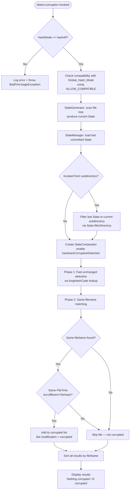

# Design Document: Corruption Detection

## Overview

This design documents the Hardware Corruption Detection subsystem of FIM (File Integrity Manager). Corruption detection identifies files whose content has silently changed (different hash) while their timestamps remain unchanged — the hallmark of hardware failures or filesystem bugs, as opposed to intentional user modifications.

The feature consists of three layers:

- **Command layer**: `DetectCorruptionCommand` (`detect-corruption` / `dcor`) — the user-facing entry point that orchestrates state generation, loading, and comparison.
- **Comparison engine**: `StateComparator` in hardware corruption detection mode — a specialized path through the comparison pipeline that skips rename/copy/duplicate/added/deleted detection and focuses exclusively on the corruption pattern.
- **Result model**: `CompareResult` with a dedicated `corrupted` list, `Modification.corrupted` enum value, and corruption-specific display formatting.

The corruption pattern is defined as: a file with the **same fileName** and **same FileTime** (both creationTime and lastModified) but a **different FileHash** compared to the previous committed state.

## Architecture

```mermaid
graph TD
    subgraph Command Layer
        DCC[DetectCorruptionCommand]
    end

    subgraph Internal Services
        SG[StateGenerator]
        SM[StateManager]
        SC[StateComparator]
    end

    subgraph Model
        S[State]
        FS[FileState]
        FH[FileHash]
        FT[FileTime]
        CR[CompareResult]
        DIFF[Difference]
        MOD[Modification]
        CTX[Context]
        HM[HashMode]
    end

    DCC -->|"generates current state"| SG
    DCC -->|"loads last state"| SM
    DCC -->|"creates with hardwareCorruption=true"| SC

    SC -->|"produces"| CR
    SC -->|"reads previous"| S
    SC -->|"reads current"| S
    SC -->|"reads"| CTX

    CR -->|"contains corrupted list of"| DIFF
    DIFF -->|"wraps current + previous"| FS

    S -->|"contains"| FS
    FS -->|"contains"| FH
    FS -->|"contains"| FT
    FS -->|"has"| MOD

    DCC -->|"checks"| HM
```



### Corruption Detection Pipeline



### Key Design Decisions

1. **hashAll requirement**: Corruption detection requires `HashMode.hashAll` because partial hashes (small block, medium block) could miss corruption in unhashed portions of the file. The command aborts immediately if the hash mode is not `hashAll`.

2. **Timestamp-based discrimination**: The corruption pattern relies on the observation that user modifications typically update file timestamps, while hardware corruption does not. A file with changed content but unchanged timestamps is suspicious. FileTime comparison uses second-level granularity (divides by 1000) to handle filesystem timestamp precision differences.

3. **Skipping non-corruption phases**: When `hardwareCorruptionDetection` is true, the `compare()` method skips `searchForDifferences()` (rename/copy/duplicate/added detection) and `searchForDeleted()` entirely. This means the CompareResult will have empty lists for added, deleted, renamed, copied, and duplicated — only the corrupted list is populated.

4. **Reuse of the StateComparator pipeline**: Rather than a separate comparator, corruption detection is implemented as a mode flag within `StateComparator`. The first two phases (fast unchanged detection and same-filename matching) are shared with normal change detection. The corruption-specific logic is a branch within `searchForSameFileNames()`.

5. **Fluent API for mode activation**: `searchForHardwareCorruption()` returns `this`, enabling the chained call pattern: `new StateComparator(ctx, last, current).searchForHardwareCorruption().compare()`.

## Components and Interfaces

### DetectCorruptionCommand (`org.fim.command.DetectCorruptionCommand`)

User-facing command for hardware corruption detection. Extends `AbstractCommand`.

| Method | Description |
|---|---|
| `execute(Context)` | Validates hashAll mode, checks global hash mode compatibility (ALLOW_COMPATIBLE), generates current State, loads last State, filters by subdirectory if needed, creates StateComparator with hardware corruption mode, runs comparison, displays results with "Nothing corrupted" as the no-modification message. Returns `CompareResult`. |
| `getCmdName()` | Returns `"detect-corruption"`. |
| `getShortCmdName()` | Returns `"dcor"`. |
| `getDescription()` | Returns description of the command's purpose. |

### StateComparator (`org.fim.internal.StateComparator`) — Corruption Mode

The comparison engine with hardware corruption detection mode.

| Method | Description |
|---|---|
| `searchForHardwareCorruption()` | Sets `hardwareCorruptionDetection = true`. Returns `this` for fluent chaining. |
| `compare()` | Executes Phase 1 (fast unchanged) and Phase 2 (same-filename matching). When `hardwareCorruptionDetection` is true, skips Phase 3 (differences), the `checkAllFilesManagedCorrectly()` integrity check, and Phase 4 (deleted) — all three sit inside the same guarded block. The check has to be skipped: files that matched by name without being corrupted stay in `addedOrModified` and are counted as neither modified nor not-modified, so the equality it asserts does not hold in this mode. Sorts and returns `CompareResult`. |

Corruption-specific logic is handled by the `handleCorruptionForSameName()` helper method, called from `searchForSameFileNames()`:
- For each file in `addedOrModified`, looks up a previous file with the same fileName.
- If found and `hardwareCorruptionDetection` is true, delegates to `handleCorruptionForSameName()`:
  - Checks if `FileHash` differs AND `FileTime` is equal.
  - If both conditions hold: adds a `Difference(previousFileState, fileState)` to `result.getCorrupted()`, sets `fileState.setModification(Modification.corrupted)`.
  - Otherwise: the file is not classified (remains in `addedOrModified` but is not added to any result list).

### CompareResult (`org.fim.model.CompareResult`) — Corruption Display

| Method | Corruption-Relevant Behavior |
|---|---|
| `displayChanges(String)` | When verbose and corrupted list is non-empty, displays each entry with label `"Corrupted?:"` followed by file name and formatted modified attributes. |
| `displayCounts(String)` | Includes `"<count> corrupted"` in the summary line when corrupted list is non-empty. When nothing is modified, displays the `notModifiedMessage` (e.g., "Nothing corrupted"). |
| `modifiedCount()` | Includes `corrupted.size()` in the total. |
| `sortResults()` | Sorts the corrupted list by fileName along with all other lists. |

### Difference (`org.fim.model.Difference`)

| Constructor | Behavior for Corruption |
|---|---|
| `Difference(FileState prev, FileState current)` | Clones the previous FileState, restores its original hash, and stores it as `current.previousFileState`. Used for corrupted entries to preserve both the old and new state. |

## Data Models

### Corruption-Relevant Fields in FileState

| Field | Type | Role in Corruption Detection |
|---|---|---|
| `fileName` | `String` | Must match between previous and current state for corruption check. |
| `fileTime` | `FileTime` | Must be equal (same creationTime and lastModified at second granularity) for a file to be classified as corrupted. |
| `fileHash` | `FileHash` | Must differ between previous and current state for corruption classification. Contains `smallBlockHash`, `mediumBlockHash`, and `fullHash`. |
| `modification` | `Modification` | Set to `Modification.corrupted` when the corruption pattern is detected. |
| `previousFileState` | `FileState` | Stores the previous version of the file for the Difference entry. |

### FileTime Equality Semantics

`FileTime.equals()` compares both `creationTime` and `lastModified` at second granularity (divides by 1000). This is critical for corruption detection — it means sub-second timestamp differences are ignored, which accommodates filesystem precision variations.

```java
return Objects.equals(this.creationTime / 1000, otherFileTime.creationTime / 1000)
       && Objects.equals(this.lastModified / 1000, otherFileTime.lastModified / 1000);
```

### FileHash Equality Semantics

`FileHash.equals()` compares all three hash components: `smallBlockHash`, `mediumBlockHash`, and `fullHash`. All three must match for two FileHash objects to be considered equal.

### Modification Enum

The `corrupted` value in the `Modification` enum is used exclusively by the hardware corruption detection mode. It is distinct from `contentModified`, which is used in normal change detection for files with changed content.

### CompareResult Corruption List

The `corrupted` field (`List<Difference>`) is populated only when `hardwareCorruptionDetection` is enabled in the StateComparator. In normal comparison mode, this list remains empty. The list is included in `modifiedCount()` and `somethingModified()` calculations.

### HashMode Constraint

| Value | Corruption Detection |
|---|---|
| `hashAll` | Required. Only mode that hashes entire file content. |
| `hashSmallBlock` | Rejected. Command aborts with error. |
| `hashMediumBlock` | Rejected. Command aborts with error. |
| `dontHash` | Rejected. Command aborts with error. |


## Correctness Properties

*A property is a characteristic or behavior that should hold true across all valid executions of a system — essentially, a formal statement about what the system should do. Properties serve as the bridge between human-readable specifications and machine-verifiable correctness guarantees.*

### Property 1: Non-hashAll mode rejection

*For any* HashMode that is not `hashAll` (i.e., `dontHash`, `hashSmallBlock`, or `hashMediumBlock`), when the `DetectCorruptionCommand.execute()` is invoked with a Context using that HashMode, the command should throw a `BadFimUsageException`.

**Validates: Requirements 1.1, 1.2**

### Property 2: Subdirectory filtering preserves only subtree files

*For any* State and any subdirectory path within the repository, filtering the State via `filterDirectory` should produce a State containing only FileState entries whose fileName starts with the relative subdirectory prefix, and no entries outside that prefix.

**Validates: Requirements 2.1**

### Property 3: Corruption classification correctness

*For any* previous State and current State compared in hardware corruption detection mode, if a file has the same fileName and the same FileTime (at second granularity) but a different FileHash, then that file should appear in the CompareResult's corrupted list as a Difference with both previous and current FileState present, the current FileState's modification set to `corrupted`, the previous and current FileState having the same fileName, the same FileTime, and different FileHash values.

**Validates: Requirements 3.3, 4.1, 4.2, 6.1, 6.2, 6.3**

### Property 4: No false positives when hash is unchanged

*For any* previous State and current State compared in hardware corruption detection mode, if a file has the same fileName and the same FileHash as the previous State, that file should not appear in the corrupted list, regardless of whether the FileTime has changed.

**Validates: Requirements 4.3, 6.4**

### Property 5: No false positives when timestamp changed

*For any* previous State and current State compared in hardware corruption detection mode, if a file has the same fileName but a different FileTime compared to the previous State, that file should not appear in the corrupted list, regardless of whether the FileHash has changed.

**Validates: Requirements 4.4, 6.5**

### Property 6: Non-corruption lists empty in corruption mode

*For any* two States compared in hardware corruption detection mode, the CompareResult should have empty `added`, `deleted`, `renamed`, `copied`, and `duplicated` lists.

**Validates: Requirements 3.4, 3.5, 3.6, 3.7, 3.8, 6.6**

### Property 7: Corrupted list sorted by fileName

*For any* CompareResult produced by a StateComparator in hardware corruption detection mode, after `compare()` returns, the corrupted list should be sorted in ascending order by `fileState.getFileName()`.

**Validates: Requirements 3.9, 5.5**

### Property 8: modifiedCount includes corrupted entries

*For any* CompareResult, the value returned by `modifiedCount()` should equal the sum of the sizes of all modification lists including the corrupted list. Specifically, `modifiedCount() >= corrupted.size()`. Note: `modifiedCount()` includes corrupted entries, but `getModificationCounts()` (which returns a `ModificationCounts` object) does NOT set the corrupted field — this is a known inconsistency in the codebase.

**Validates: Requirements 5.4**

## Error Handling

### Command-Level Errors

| Error Condition | Handler | Behavior |
|---|---|---|
| HashMode is not `hashAll` | `DetectCorruptionCommand.execute()` | Logs `"Hardware corruption detection require to hash all the file content."` via `Logger.error()`, throws `BadFimUsageException`. |
| Incompatible global hash mode | `AbstractCommand.checkHashMode()` with `ALLOW_COMPATIBLE` | If compatible: logs info message and proceeds. If incompatible: logs warning and forces hash mode to global setting. |

### StateComparator Errors

| Error Condition | Handler | Behavior |
|---|---|---|
| Model version mismatch between states | `StateComparator.init()` | Logs warning, sets `lastState` to `null`. In corruption mode this means no files will be found in the previous state, so no corruption will be detected. |

### Display Edge Cases

| Condition | Handler | Behavior |
|---|---|---|
| No corrupted files and no other modifications | `CompareResult.displayCounts()` | Displays the `notModifiedMessage` provided by the caller ("Nothing corrupted"). |
| `previousFileState` is null in a Difference (pre-1.2.1 states) | `CompareResult.getPreviousFileName()` | Returns `"?"` as placeholder. |

## Testing Strategy

### Dual Testing Approach

Testing for the Corruption Detection feature uses both example-based unit tests and correctness property tests:

- **Unit tests**: Verify specific examples, edge cases, and display formatting. Focus on concrete scenarios like "command with hashAll proceeds without error", "subdirectory invocation filters state", "verbose output shows Corrupted?: label", and "Nothing corrupted message when no corruption found".
- **Correctness property tests**: Verify universal properties across a range of generated States and FileStates, enumerated exhaustively where the input domain allows and sampled from a fixed seed otherwise. Focus on corruption classification correctness, false positive prevention, and structural invariants.

### Correctness Property Test Configuration

- **Framework**: JUnit 5 (Jupiter) `@ParameterizedTest` with AssertJ assertions. No separate property-based testing library is used; the project deliberately has no PBT dependency.
- **Input domains**: where a property's domain is small it is enumerated **exhaustively** (`IntStream.rangeClosed(..)`, `@EnumSource`, or a full cross product via `Stream<Arguments>`). Every value then runs on every build, and a failing case is already the minimal one. Domains too wide to enumerate (file sizes, generated names, composite objects) are sampled instead, with the boundary values listed explicitly.
- **Sampling**: `org.fim.tooling.RandomInputs` supplies the seeded generators. Its `SEED` is fixed, so a failing case reproduces on any machine. Nothing shrinks a failing input automatically, which is why boundaries are stated explicitly rather than discovered.
- **Preconditions**: a property that only holds above some input threshold narrows its provider range rather than using an assumption, so no case is silently skipped.
- **Tag format**: Each property test must include a comment referencing the design property:
  ```java
  // Feature: corruption-detection, Property 3: Corruption classification correctness
  ```
- Each correctness property (Properties 1–8) must be implemented by a single parameterized test.

### Test Categories

**Correctness property tests** (one per correctness property):
- Non-hashAll mode rejection (Property 1)
- Subdirectory filtering preserves only subtree files (Property 2)
- Corruption classification correctness (Property 3)
- No false positives when hash is unchanged (Property 4)
- No false positives when timestamp changed (Property 5)
- Non-corruption lists empty in corruption mode (Property 6)
- Corrupted list sorted by fileName (Property 7)
- modifiedCount includes corrupted entries (Property 8)

**Unit tests** (specific examples and edge cases):
- DetectCorruptionCommand with hashAll mode proceeds and returns CompareResult (Req 1.3, 1.6)
- "Nothing corrupted" message displayed when no corruption found (Req 1.7, 5.3)
- Subdirectory invocation filters last state (Req 2.1, 2.3)
- Root invocation uses full state without filtering (Req 2.2)
- searchForHardwareCorruption() enables corruption mode (Req 3.1)
- Verbose output displays "Corrupted?:" label with file name and modified attributes (Req 5.1)
- Summary line includes "<count> corrupted" format (Req 5.2)
