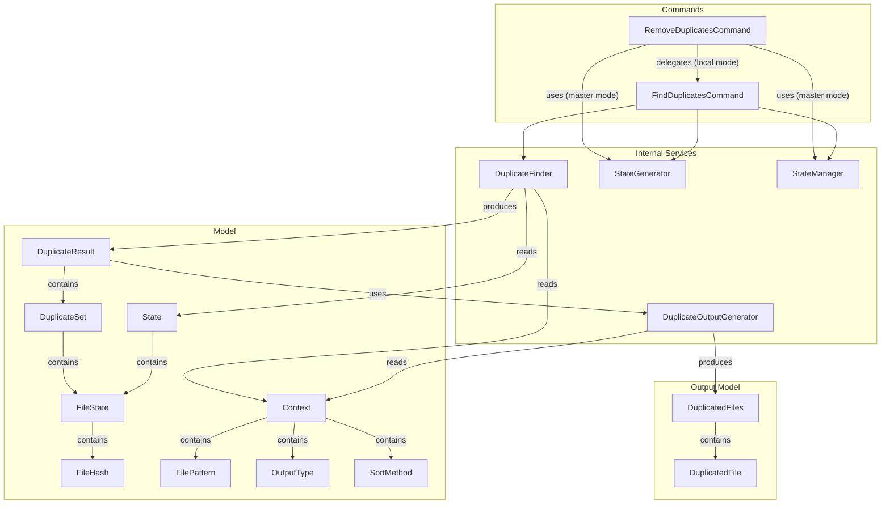
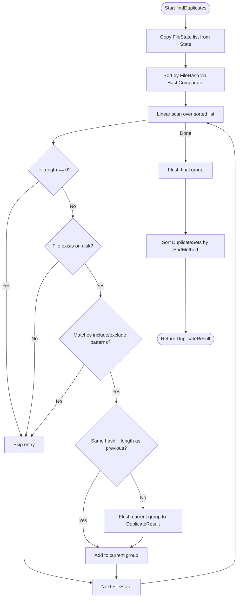

# Design Document: Duplicate Detection

## Overview

This design documents the Duplicate Detection and Removal subsystem of FIM (File Integrity Manager). It enables users to find files with identical content within a FIM repository and optionally remove the duplicates to reclaim disk space. The subsystem also supports cross-repository deduplication against a master FIM repository.

The feature comprises:

- **Command layer**: `FindDuplicatesCommand` (`fdup`) for detection-only and `RemoveDuplicatesCommand` (`rdup`) for removal, including master-repository mode.
- **Detection engine**: `DuplicateFinder`, which sorts FileState entries by hash and groups consecutive entries with matching FileHash and fileLength into DuplicateSets.
- **Output generation**: `DuplicateOutputGenerator`, which formats results as CSV or JSON. The human-readable format is rendered by `DuplicateResult` itself, because it is interleaved with the interactive removal prompts.
- **Result model**: `DuplicateResult` (aggregate statistics, sorting, interactive removal logic) and `DuplicateSet` (a group of duplicate files with wasted space calculation).

The detection algorithm is a single-pass linear scan over hash-sorted FileState entries, with filtering for zero-length files, non-existent files, and file pattern matching.

## Architecture



### Detection Pipeline



### Key Design Decisions

1. **Sort-then-scan for grouping**: Rather than using a hash map, `DuplicateFinder` sorts all FileState entries by `FileHash` (via `FileState.HashComparator`) and then performs a single linear scan. Consecutive entries with the same hash and file length form a duplicate group. This is O(n log n) for the sort and O(n) for the scan, with minimal memory overhead.

2. **Dual grouping criteria (hash + length)**: Two files are considered duplicates only if both their `FileHash` and `fileLength` match. This guards against hash collisions — files with the same hash but different lengths are not grouped together.

3. **Eager filtering**: Zero-length files, non-existent files, and pattern-excluded files are skipped during the scan rather than post-filtered. This avoids creating spurious DuplicateSets.

4. **DuplicateSet with pre-computed wasted space**: `DuplicateSet` computes `wastedSpace` at construction time as `(fileCount - 1) * fileLength` and exposes its file list as an unmodifiable view via `Collections.unmodifiableList()`. Note: while the list reference is unmodifiable, the `FileState` objects within the list are mutable — `selectFilesToRemove()` mutates them by calling `setToRemove(true)` during interactive removal.

5. **Two-mode removal**: Local removal (no `-M` flag) delegates to `FindDuplicatesCommand` with `removeDuplicates=true`, reusing the full detection pipeline. Master-repository removal builds a `HashMap<FileHash, FileState>` from the master state and checks each local file against it — a fundamentally different algorithm suited to cross-repository comparison.

6. **Interactive preservation prompt**: During local removal, the user selects which files to *preserve* (not which to delete). All files default to removal, and the user's selections un-mark them. This "preserve" model is safer — the user explicitly chooses what to keep.

7. **Safety confirmation for automatic removal**: When both `removeDuplicates` and `alwaysYes` are set, `FindDuplicatesCommand` temporarily disables `alwaysYes` and shows an explicit confirmation prompt. This prevents accidental mass deletion. The check is skipped when `calledFromTest` is true. The flag is put back immediately after the answer, whatever it was: `confirmAction()` only re-arms it for the answer `A`, so leaving it to do so meant that answering `y` disabled `-y` for the rest of the run and every duplicate set asked which file to preserve. Restoring on refusal costs nothing, since the command aborts there.

8. **A Context per directory tree in master mode**: `-M` involves two unrelated trees, so each is read through its own clone of the `Context`, carrying the repository root that tree actually describes — the master for the State being loaded, the current directory for the tree being scanned. The caller's `Context` keeps its own root and is what the prompts and the removals use, so answering `A` still carries across the run. Repointing the single live `Context` at the master, as the earlier design did, left the scan describing one tree while its root named another: `FimIgnoreManager` derives from that root and walks up from the current directory to it, and since the current directory has to sit outside the master (Requirements 11.3, 11.4) that walk never arrived and ran to the top of the filesystem instead, applying unrelated `.fimignore` files. That is precisely the case of running `-M` from inside a Fim repository, which is what the option is for.

9. **Master lookup keyed by hash alone**: `buildFileHashMap()` builds a `HashMap<FileHash, FileState>`, so one master file is retained per hash. Where a master holds several copies of the same content, the reported match is one of them rather than all of them. Matching is on `FileHash` only; unlike local detection, `fileLength` is not part of the key.

10. **Removal failures reported once, with the reason**: `FileUtil.removeFile()` resolves the path, attempts the deletion, and reports a failure a single time after all attempts, naming the file and the exception. A missing file is not retried, since only contention is worth waiting on. When the name cannot be encoded in the JVM's `sun.jnu.encoding`, the report says so and asks for a UTF-8 locale — that charset follows the process locale and cannot be set with a system property, so the advice cannot be a JVM flag.

## Components and Interfaces

### FindDuplicatesCommand (`org.fim.command.FindDuplicatesCommand`)

The primary command for finding duplicate files within a FIM repository.

| Method | Description |
|---|---|
| `execute(Context)` | Validates hash mode, checks for incompatible remove+non-human output, handles safety confirmation for auto-removal, loads or generates State, runs `DuplicateFinder.findDuplicates()`, calls `displayAndRemoveDuplicates()`. Returns `DuplicateResult`. |
| `getCmdName()` | Returns `"find-duplicates"`. |
| `getShortCmdName()` | Returns `"fdup"`. |

### RemoveDuplicatesCommand (`org.fim.command.RemoveDuplicatesCommand`)

Handles both local and master-repository duplicate removal.

| Method | Description |
|---|---|
| `execute(Context)` | If no master dir: sets `removeDuplicates=true` and delegates to `FindDuplicatesCommand`. If master dir: validates the master repository, loads the master State through a clone rooted at the master, scans the current directory through a clone rooted at that directory, compares file hashes, and prompts through the caller's Context for removal of each match. Always rescans; `-l` has no effect in this mode. Returns files-removed count. |
| `buildFileHashMap(State)` | Builds a `HashMap<FileHash, FileState>` from the master State, retaining one FileState per hash. |
| `getCmdName()` | Returns `"remove-duplicates"`. |
| `getShortCmdName()` | Returns `"rdup"`. |
| `getFimReposConstraint()` | Returns `DONT_CARE` (works outside FIM repos for master mode). |

### DuplicateFinder (`org.fim.internal.DuplicateFinder`)

The core detection engine.

| Method | Description |
|---|---|
| `findDuplicates(State)` | Copies the FileState list, sorts by hash, performs a single-pass linear scan grouping consecutive entries with matching FileHash and fileLength (filtering out zero-length, non-existent, and pattern-excluded files), flushes groups to `DuplicateResult`, sorts result sets. Returns `DuplicateResult`. |

### DuplicateOutputGenerator (`org.fim.internal.DuplicateOutputGenerator`)

Formats `DuplicateResult` for non-human output types.

| Method | Description |
|---|---|
| `generate(DuplicateResult)` | Converts DuplicateSets to a `DuplicatedFiles` list, then dispatches to the CSV or JSON generator based on `OutputType`. Rejects `human` with an `IllegalStateException`, since that format is rendered by `DuplicateResult` and this generator is never called for it. |
| `generateCSV(List<DuplicatedFiles>)` | Writes CSV with header `SetIndex, FileIndex, WastedSpace, FilePath, FileName, FileLength, FileType` using Apache Commons CSV. |
| `generateJson(List<DuplicatedFiles>)` | Serializes the list to JSON using Jackson `ObjectMapper`. |

### DuplicateResult (`org.fim.model.DuplicateResult`)

Aggregates duplicate detection results and handles display/removal logic.

| Method | Description |
|---|---|
| `addDuplicatedFiles(List<FileState>)` | Adds a group as a `DuplicateSet` if size > 1. Updates `duplicatedFilesCount` by adding `(size - 1)`. Updates `totalWastedSpace` by summing the `fileLength` of each file after index 0 (i.e., iterating files at indices 1..n-1 and adding their individual lengths). Since all files in a duplicate set share the same `fileLength` (grouped by hash AND length), this produces the same result as `(size - 1) * firstFile.fileLength`, but uses a different algorithm. |
| `sortDuplicateSets()` | Sorts the DuplicateSet list using the comparator selected by `Context.getSortMethod()`. |
| `displayAndRemoveDuplicates()` | For non-human output: delegates to `DuplicateOutputGenerator`. For human output: iterates sets (if verbose or removing), manages interactive removal, displays summary. |
| `selectFilesToRemove(List<FileState>)` | If `alwaysYes`: marks all except first for removal. Otherwise: displays indexed file list and prompts user for preservation choices. |
| `manageAnswers(List<FileState>, String)` | Parses user input: numeric indices preserve specific files, "all"/"a" preserves all, "none"/"n" removes all. Every file is marked for removal first and the preserved ones are then un-marked, so the flags are recomputed from scratch on each attempt and a rejected answer leaves nothing behind. "none"/"n" also adds one file and one file length to `duplicatedFilesCount` and `totalWastedSpace`, since removing the whole set removes one file more than the set was counted as wasting. |
| `readInputLine()` | Reads one answer from a single `Scanner` over `System.in`, created on first use and held for the life of the object. Closing a `Scanner` closes its source, so a closed one would leave later prompts unable to read, and a fresh instance per prompt could discard input already buffered past the line it returned. Raises `DontWantToContinueException` when standard input ends, rather than looping on input that cannot arrive. |
| `createDuplicateSetComparator()` | Selects the comparator for the configured `SortMethod`. The switch is exhaustive over the enum with no default arm, so a new SortMethod without a comparator fails to compile; a `null` comparator would otherwise reach `List.sort` as natural ordering, and `DuplicateSet` is not `Comparable`. |

Inner comparator classes:
- `WastedSpaceComparator` — sorts by `DuplicateSet.getWastedSpace()`
- `NumberOfFileComparator` — sorts by `DuplicateSet.getDuplicatedFilesCount()`
- `FileSizeComparator` — sorts by `DuplicateSet.getDuplicatedFileSize()`
- `FilePathComparator` — sorts by `DuplicateSet.getPathOrderingKey()`

### DuplicateSet (`org.fim.model.DuplicateSet`)

An immutable group of duplicate files.

| Method | Description |
|---|---|
| `DuplicateSet(List<FileState>)` | Copies the file list and computes `wastedSpace = (size - 1) * firstFile.fileLength`. |
| `getDuplicatedFiles()` | Returns unmodifiable view of the file list. |
| `getWastedSpace()` | Returns pre-computed wasted space. |
| `getDuplicatedFilesCount()` | Returns file list size. |
| `getDuplicatedFileSize()` | Returns `fileLength` of the first file. |
| `getPathOrderingKey()` | Returns the lowest of the file names in the set, used when ordering sets by path. The lowest name rather than the first, so the key does not depend on the discovery order: sets are built while walking files sorted by hash, which says nothing about where they live. |

## Data Models

### OutputType (`org.fim.model.OutputType`)

Enum of supported output formats:

| Value | Description |
|---|---|
| `human` | Human-readable console output with formatted set headers and file listings. |
| `csv` | CSV format with header row, one row per file per set. |
| `json` | JSON array of `DuplicatedFiles` objects serialized via Jackson. |

### SortMethod (`org.fim.model.SortMethod`)

Enum of sort criteria for DuplicateSet ordering:

| Value | Description |
|---|---|
| `wasted` | Sort by total wasted space per set. Default. |
| `number` | Sort by number of files in each set. |
| `size` | Sort by individual file size of the duplicated file. |
| `path` | Sort by the set's Path_Ordering_Key, grouping together the duplicates that live in the same directory. |

### DuplicatedFiles (`org.fim.model.output.DuplicatedFiles`)

Output model for structured (CSV/JSON) output of a single duplicate set.

| Field | Type | Description |
|---|---|---|
| `fileList` | `List<DuplicatedFile>` | The files in this duplicate set. |
| `wastedSpace` | `long` | Wasted space for this set. |

### DuplicatedFile (`org.fim.model.output.DuplicatedFile`)

Output model for a single file within a duplicate set.

| Field | Type | Description |
|---|---|---|
| `path` | `String` | Directory path extracted from fileName (everything before last `/`). |
| `name` | `String` | Full file name (relative to repository root). |
| `length` | `long` | File size in bytes. |
| `type` | `String` | File extension (lowercase, extracted after last `.`). Empty string if no extension. |

### Context Fields Relevant to Duplicate Detection

| Field | Type | Default | Description |
|---|---|---|---|
| `outputType` | `OutputType` | `human` | Output format for duplicate results. |
| `sortMethod` | `SortMethod` | `wasted` | Sort criterion for DuplicateSet ordering. |
| `sortAscending` | `boolean` | `false` | Sort direction. Default is descending (largest first). |
| `removeDuplicates` | `boolean` | `false` | Whether to enter interactive removal mode. |
| `alwaysYes` | `boolean` | `false` | Auto-confirm all removal prompts (keep first file in each set). |
| `calledFromTest` | `boolean` | `false` | Skip safety confirmation prompt in tests. |
| `masterFimRepositoryDir` | `String` | `null` | Path to master repository for cross-repo deduplication. |
| `useLastState` | `boolean` | `false` | Use last committed state instead of scanning current files. |
| `verbose` | `boolean` | `true` | Show detailed per-set output in human mode. |
| `includePatterns` | `List<FilePattern>` | `null` | File name patterns to include in detection. |
| `excludePatterns` | `List<FilePattern>` | `null` | File name patterns to exclude from detection. |

### DuplicateResult Statistics

| Field | Type | Description |
|---|---|---|
| `duplicatedFilesCount` | `long` | Total number of duplicate files across all sets (each set contributes `size - 1`). |
| `totalWastedSpace` | `long` | Sum of wasted space across all DuplicateSets. |
| `filesRemoved` | `long` | Number of files actually deleted during removal. |
| `spaceFreed` | `long` | Total bytes freed by file removal. |

## Correctness Properties

*A property is a characteristic or behavior that should hold true across all valid executions of a system — essentially, a formal statement about what the system should do. Properties serve as the bridge between human-readable specifications and machine-verifiable correctness guarantees.*

### Property 1: DuplicateSet structural invariant

*For any* DuplicateResult produced by `DuplicateFinder.findDuplicates()`, every DuplicateSet must contain at least 2 FileState entries, and all FileState entries within a single DuplicateSet must share the same FileHash value and the same fileLength value.

**Validates: Requirements 2.2, 2.7, 12.1, 12.2, 12.3**

### Property 2: Zero-length file exclusion

*For any* State containing FileState entries with fileLength of zero, those entries should never appear in any DuplicateSet within the resulting DuplicateResult.

**Validates: Requirements 2.3**

### Property 3: File pattern filtering

*For any* State and any configured include/exclude patterns, no FileState whose file name fails the include pattern match or matches an exclude pattern should appear in any DuplicateSet within the resulting DuplicateResult.

**Validates: Requirements 2.5, 2.6**

### Property 4: Wasted space calculation per set

*For any* DuplicateSet, the `getWastedSpace()` value must equal `(getDuplicatedFilesCount() - 1) * getDuplicatedFileSize()`, where `getDuplicatedFileSize()` is the fileLength of the first file in the set.

**Validates: Requirements 3.1, 12.7**

### Property 5: Aggregate statistics consistency

*For any* DuplicateResult, `duplicatedFilesCount` must equal the sum of `(getDuplicatedFilesCount() - 1)` across all DuplicateSets, and `totalWastedSpace` must equal the sum of `getWastedSpace()` across all DuplicateSets.

**Validates: Requirements 3.2, 3.3, 12.4, 12.5**

### Property 6: Sort correctness

*For any* DuplicateResult, SortMethod, and sort direction (ascending or descending), after `sortDuplicateSets()` is called, the DuplicateSet list must be ordered according to the configured criterion: by `getWastedSpace()` for `wasted`, by `getDuplicatedFilesCount()` for `number`, by `getDuplicatedFileSize()` for `size`, by `getPathOrderingKey()` for `path` — in the configured direction.

**Validates: Requirements 2.8, 4.1, 4.2, 4.3, 4.4, 4.5, 4.6**

### Property 7: Input order independence

*For any* State, the DuplicateResult produced by `DuplicateFinder.findDuplicates()` should be the same regardless of the initial ordering of FileState entries in the State. That is, shuffling the FileState list before detection should produce an equivalent set of DuplicateSets.

**Validates: Requirements 2.1**

### Property 8: No duplicates when all hashes unique

*For any* State where every FileState has a unique FileHash (no two entries share the same hash), `DuplicateFinder.findDuplicates()` should produce a DuplicateResult with zero DuplicateSets and a `duplicatedFilesCount` of zero.

**Validates: Requirements 12.6**

### Property 9: CSV output row count

*For any* DuplicateResult with non-empty DuplicateSets, the CSV output produced by `DuplicateOutputGenerator` should contain exactly one header row plus one data row per file across all DuplicateSets, with SetIndex incrementing per set and FileIndex incrementing per file within a set.

**Validates: Requirements 6.1, 6.2**

### Property 10: Path and extension extraction

*For any* file name string, the path extraction should return everything before the last `/` (or empty string if no `/`), and the extension extraction should return the lowercase substring after the last `.` (or empty string if no `.`).

**Validates: Requirements 6.3**

### Property 11: JSON serialization round-trip

*For any* DuplicateResult, the JSON output produced by `DuplicateOutputGenerator` should be deserializable into a list of objects where each object contains a `wastedSpace` field and a `fileList` array, and each file in the list contains `name`, `length`, `path`, and `type` fields matching the original DuplicateSet data.

**Validates: Requirements 7.1, 7.2**

### Property 12: Remove with non-human output rejection

*For any* non-human OutputType (csv or json) combined with `removeDuplicates=true`, `FindDuplicatesCommand.execute()` should throw `BadFimUsageException`.

**Validates: Requirements 8.2**

### Property 13: AlwaysYes marks all except first for removal

*For any* DuplicateSet with `alwaysYes=true`, calling `selectFilesToRemove()` should mark all FileState entries except the first one (index 0) as `toRemove=true`, and the first entry should have `toRemove=false`.

**Validates: Requirements 8.3**

### Property 14: Preserve by index

*For any* DuplicateSet and any valid set of file indices provided as input to `manageAnswers()`, all files except those at the specified indices should be marked `toRemove=true`, and the specified files should be marked `toRemove=false`.

**Validates: Requirements 8.5, 8.6**

### Property 15: "all" preserves all files

*For any* DuplicateSet, when `manageAnswers()` receives input "all" or "a", no files in the set should be marked `toRemove=true`.

**Validates: Requirements 8.7**

### Property 16: "none" removes all files

*For any* DuplicateSet, when `manageAnswers()` receives input "none" or "n", all files in the set should be marked `toRemove=true`.

**Validates: Requirements 8.8**

### Property 17: Master repository hash matching with zero-length exclusion

*For any* local FileState and master State, the local file is identified as a duplicate of a master file if and only if its FileHash matches a FileHash in the master State and its fileLength is greater than zero.

**Validates: Requirements 10.3, 10.8**

### Property 18: dontHash mode rejection

*For any* Context with HashMode set to `dontHash`, executing `FindDuplicatesCommand` or `RemoveDuplicatesCommand` should throw `BadFimUsageException` with the message "File content hashing mandatory for this command".

**Validates: Requirements 1.1**

## Error Handling

### Command-Level Errors

| Error Condition | Handler | Behavior |
|---|---|---|
| `dontHash` hash mode | `AbstractCommand.fileContentHashingMandatory()` | Logs "File content hashing mandatory for this command" and throws `BadFimUsageException`. |
| Remove duplicates with non-human output | `FindDuplicatesCommand.execute()` | Logs "You cannot display duplicates in a non human format and remove them" and throws `BadFimUsageException`. |
| User declines safety confirmation for auto-removal | `FindDuplicatesCommand.explicitlyConfirmAutomaticRemoval()` | Throws `DontWantToContinueException`. |
| Incompatible hash mode with global setting | `AbstractCommand.checkHashMode()` | Logs warning and forces hash mode to global setting. |

### Master Repository Validation Errors

| Error Condition | Handler | Behavior |
|---|---|---|
| Master directory does not exist | `Fim.manageMasterFimOption()` | Logs "Master Fim repository directory '&lt;dir&gt;' does not exist" while parsing the command line and throws `BadFimUsageException`. A caller setting `masterFimRepositoryDir` directly hits the `.fim` check below instead, a missing directory having no `.fim` in it. |
| Master directory has no `.fim` directory | `RemoveDuplicatesCommand.execute()` | Logs "Directory is not a Fim repository" and throws `BadFimUsageException`. |
| Current directory equals master directory | `RemoveDuplicatesCommand.execute()` | Logs "Cannot remove duplicates into the master directory" and throws `BadFimUsageException`. |
| Current directory is subdirectory of master | `RemoveDuplicatesCommand.execute()` | Logs "Cannot remove duplicates into a sub-directory of the master directory" and throws `BadFimUsageException`. |
| Reduced hash mode for master removal | `RemoveDuplicatesCommand.execute()` | Displays warning about reduced mode, prompts for confirmation. Throws `DontWantToContinueException` if declined. |

### Output Generation Errors

| Error Condition | Handler | Behavior |
|---|---|---|
| IOException during CSV generation | `DuplicateOutputGenerator.generateCSV()` | Logs "Error displaying duplicates in CSV format" with exception details (if `displayStackTrace` is enabled). |
| IOException during JSON generation | `DuplicateOutputGenerator.generateJson()` | Logs "Error displaying duplicates in JSON format" with exception details (if `displayStackTrace` is enabled). |

### Interactive Removal Errors

| Error Condition | Handler | Behavior |
|---|---|---|
| Invalid (non-numeric, out-of-range) input at preservation prompt | `DuplicateResult.manageAnswers()` | `safeParseInt()` returns -1, index check fails, input is silently ignored. Loop continues prompting. |
| Standard input ends while an answer is awaited | `DuplicateResult.readInputLine()` | Throws `DontWantToContinueException`, rather than looping on input that cannot arrive. |
| File removal fails on disk | `FileUtil.removeFile()` | Returns `false` and reports once, after all attempts, naming the path and the exception. The file counts as neither removed nor freed space and is listed without the `[-]` marker. A `NoSuchFileException` is not retried. |
| File name not representable in `sun.jnu.encoding` | `FileUtil.removeFile()` | The failure report adds that the name cannot be represented in that encoding and asks for a UTF-8 locale. Detected by testing the name against the charset, and by the presence of the Unicode replacement character. |

Note: `DuplicateResult` holds one `Scanner` over `System.in` for the life of the object and never closes it. Closing a `Scanner` closes its source, which would leave later prompts unable to read; a fresh instance per prompt could also discard input buffered past the line it returned.

## Testing Strategy

### Dual Testing Approach

Testing for the Duplicate Detection feature uses both example-based unit tests and correctness property tests:

- **Unit tests**: Verify specific examples, edge cases, error conditions, and integration scenarios. Focus on concrete scenarios like command execution flow, master repository validation, display output formatting, and interactive removal behavior.
- **Correctness property tests**: Verify universal properties across a range of generated States, FileStates, and DuplicateSets, enumerated exhaustively where the input domain allows and sampled from a fixed seed otherwise. Focus on detection correctness (invariants, filtering, aggregation), sorting, output structure, and removal logic.

### Correctness Property Test Configuration

- **Framework**: JUnit 5 (Jupiter) `@ParameterizedTest` with AssertJ assertions. No separate property-based testing library is used; the project deliberately has no PBT dependency.
- **Input domains**: where a property's domain is small it is enumerated **exhaustively** (`IntStream.rangeClosed(..)`, `@EnumSource`, or a full cross product via `Stream<Arguments>`). Every value then runs on every build, and a failing case is already the minimal one. Domains too wide to enumerate (file sizes, generated names, composite objects) are sampled instead, with the boundary values listed explicitly.
- **Sampling**: `org.fim.tooling.RandomInputs` supplies the seeded generators. Its `SEED` is fixed, so a failing case reproduces on any machine. Nothing shrinks a failing input automatically, which is why boundaries are stated explicitly rather than discovered.
- **Preconditions**: a property that only holds above some input threshold narrows its provider range rather than using an assumption, so no case is silently skipped.
- **Tag format**: Each property test must include a comment referencing the design property:
  ```java
  // Feature: duplicate-detection, Property 1: DuplicateSet structural invariant
  ```
- Each correctness property (Properties 1–18) must be implemented by a single parameterized test.

### Test Categories

**Correctness property tests** (one per correctness property):
- DuplicateSet structural invariant (Property 1)
- Zero-length file exclusion (Property 2)
- File pattern filtering (Property 3)
- Wasted space calculation per set (Property 4)
- Aggregate statistics consistency (Property 5)
- Sort correctness (Property 6)
- Input order independence (Property 7)
- No duplicates when all hashes unique (Property 8)
- CSV output row count (Property 9)
- Path and extension extraction (Property 10)
- JSON serialization round-trip (Property 11)
- Remove with non-human output rejection (Property 12)
- AlwaysYes marks all except first (Property 13)
- Preserve by index (Property 14)
- "all" preserves all files (Property 15)
- "none" removes all files (Property 16)
- Master repository hash matching with zero-length exclusion (Property 17)
- dontHash mode rejection (Property 18)

**Unit tests** (specific examples and edge cases):
- find-duplicates with `--use-last-state` loads last committed state (Req 1.2)
- find-duplicates without `--use-last-state` generates new state (Req 1.3)
- find-duplicates displays result using configured OutputType (Req 1.4)
- Compatible hash mode logs info message (Req 1.5)
- Non-existent files excluded from detection (Req 2.4)
- "No duplicate file found" message when no duplicates (Req 5.3)
- Summary-only output when verbose is disabled (Req 5.4)
- remove-duplicates without `-M` delegates to FindDuplicatesCommand (Req 8.1)
- Safety confirmation prompt for auto-removal (Req 9.1)
- Declining safety prompt aborts without scanning (Req 9.2)
- calledFromTest skips safety prompt (Req 9.3)
- Master repository loads last state and generates local state (Req 10.1, 10.2)
- Master repository duplicate removal with confirmation (Req 10.5)
- "No duplicate file found" for master with no matches (Req 10.7)
- Master directory does not exist (Req 11.1)
- Master directory is not a FIM repository (Req 11.2)
- Cannot remove into master directory (Req 11.3)
- Cannot remove into subdirectory of master (Req 11.4)
- Reduced hash mode warning for master removal (Req 11.5)
