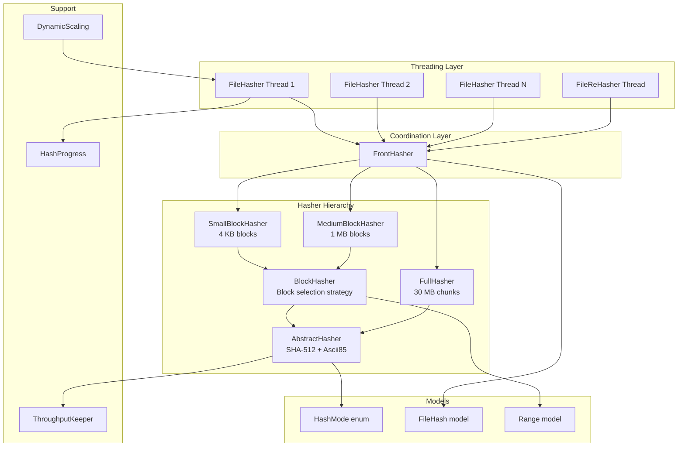

# Design Document: File Hashing System

## Overview

The File Hashing System is the core subsystem of FIM (File Integrity Manager) responsible for computing cryptographic hashes of file contents. It implements a multi-mode, multi-threaded architecture that supports four hash modes — from no hashing to full SHA-512 hashing — enabling users to trade off between speed and integrity coverage.

The system uses a layered hasher hierarchy where a `FrontHasher` coordinates three independent hashers (`SmallBlockHasher`, `MediumBlockHasher`, `FullHasher`), each targeting different portions of a file. Block-based hashers sample strategic positions (beginning, middle, end) to provide fast approximate integrity checks, while the full hasher processes every byte. All hashers use SHA-512 with Ascii85 encoding for compact, printable hash strings.

File I/O is performed via memory-mapped buffers (`MappedByteBuffer`) for efficiency, and multiple `FileHasher` threads consume file paths from a shared `BlockingDeque`. A `DynamicScaling` component adjusts thread count at runtime based on observed disk throughput.

## Architecture

The architecture follows a template method pattern with a coordinating front-end:



### Key Design Decisions

1. **Template Method Pattern**: `AbstractHasher` provides the SHA-512 digest lifecycle (reset, update, getHash) while subclasses define block selection via `getNextBlockToHash()`. This avoids code duplication across hasher types.

2. **Composite Coordination via FrontHasher**: Rather than having `FileHasher` manage three hashers directly, `FrontHasher` encapsulates range merging and buffer dispatch. This isolates the complex range coordination logic.

3. **Block Skipping Strategy**: Block-based hashers skip the first block (index 0) when files are large enough, because file headers (magic bytes, metadata) are often identical across files of the same type, increasing collision risk.

4. **Memory-Mapped I/O**: `FileHasher` uses `FileChannel.map()` for zero-copy reads. Explicit unmapping through `sun.misc.Unsafe.invokeCleaner()`, reached by reflection, handles the JVM's non-deterministic buffer cleanup to prevent `OutOfMemoryError` during large scans. Nothing forces a garbage collection to achieve this: releasing each buffer as soon as it has been hashed is what keeps the mapped memory bounded.

5. **Cumulative Hash Mode Compatibility**: Hash modes are ordered (`dontHash < hashSmallBlock < hashMediumBlock < hashAll`), and each higher mode activates all hashers from lower modes. `HashModeUtil.isCompatible()` implements this transitive relationship.

## Components and Interfaces

### Hasher Interface

The `Hasher` interface defines the contract for all hash computation components:

```java
public interface Hasher {
    boolean isActive();                          // Whether this hasher is enabled for the current HashMode
    void reset(long fileSize);                   // Reset state for a new file
    Range getNextRange(long filePosition);       // Next byte range needed from the file
    void update(long filePosition, ByteBuffer buffer); // Feed file data to the digest
    String getHash();                            // Get the final Ascii85-encoded SHA-512 hash
    long getBytesHashed();                       // Per-file bytes hashed so far
    boolean hashComplete();                      // Whether all expected bytes have been hashed
    long getTotalBytesHashed();                  // Cumulative bytes across all files
    long getInstantThroughput();                 // Current throughput in bytes/sec
}
```

### AbstractHasher

Base class implementing `Hasher`. Manages the `MessageDigest` (SHA-512) lifecycle, byte counting, and throughput tracking via `ThroughputKeeper`. Subclasses implement:
- `isCompatible(HashMode)` — determines if this hasher is active for a given mode
- `getNextBlockToHash(filePosition, currentPosition, buffer)` — extracts the relevant bytes from a buffer

The `update()` method iterates through blocks within a buffer, feeding each to the digest and accumulating byte counts.

An inactive hasher creates no `MessageDigest` at all, and reports `NO_HASH`, zero bytes hashed and `hashComplete() == true`. `reset()` is likewise a no-op for it.

The `ThroughputKeeper` is only constructed when `Context.isUseDynamicScaling()` is set, and `update()` only feeds it under the same condition. `getInstantThroughput()` does not repeat that check, so it is only defined while dynamic scaling is enabled; calling it with scaling disabled dereferences a keeper that was never created. No production path does: the chain `FileHasher.getInstantThroughput()` → `FrontHasher` → `AbstractHasher` exists but has no caller, so this is a precondition on the accessor rather than a reachable defect.

### BlockHasher

Abstract subclass of `AbstractHasher` for block-sampling hashers. On `reset()`, it computes which blocks to hash based on file size:
- Files > 4× blockSize: blocks at index 1, middle, and end (3 blocks)
- Files > 3× blockSize: blocks at index 1 and end (2 blocks)
- Files > 2× blockSize: block at index 1 (1 block)
- Files ≤ 2× blockSize: block at index 0 (1 block)

Each block is represented as a `Range` object. `getNextRange()` returns the first range at or after the given file position. `hashComplete()` checks that `bytesHashed == sizeToHash` (sum of all selected ranges).

### SmallBlockHasher

Concrete `BlockHasher` with `blockSize = 4 KB` (4,096 bytes). Active when `HashMode >= hashSmallBlock`.

### MediumBlockHasher

Concrete `BlockHasher` with `blockSize = 1 MB` (1,048,576 bytes). Active when `HashMode >= hashMediumBlock`.

### FullHasher

Extends `AbstractHasher` directly (not `BlockHasher`). Hashes the entire file in 30 MB chunks. `getNextRange()` returns sequential 30 MB ranges. `hashComplete()` checks `bytesHashed == fileSize`. Active when `HashMode == hashAll`.

### FrontHasher

Coordinates the three hashers. Key responsibilities:
- **Range merging** (`getNextRange`): In `hashAll` mode, starts with the FullHasher's 30 MB range and adjusts it to encompass any overlapping block hasher ranges. In `hashMediumBlock` mode, returns the earlier non-overlapping range or the union of overlapping ranges, and returns whichever range is non-null when the other has run out. In `hashSmallBlock` mode, delegates directly. With no hasher active — `dontHash` — it throws `FimInternalError`; that mode never reaches here, because `FileHasher.hashFile()` returns an all-`NO_HASH` `FileHash` before opening the file.
- **Buffer dispatch** (`update`): Forwards each buffer to all active hashers, restoring the buffer position and limit after each one in a `finally` block, so every hasher sees the buffer as it was handed over.
- **Hash assembly** (`getFileHash`): Produces a `FileHash` from the three individual hash results.

Two details of its `Hasher` implementation are worth stating, since `FrontHasher` implements the interface without being a hasher itself:
- `isActive()` is the conjunction of the three, so it is true only in `hashAll` mode, where all three are active. It is not a "any work to do" flag, and `FileHasher` does not consult it.
- `getHash()` throws `FimInternalError("Not implemented")`. A single combined hash string is meaningless here; callers use `getFileHash()`, which returns the three-part `FileHash`.
- `getBytesHashed()`, `getTotalBytesHashed()` and `getInstantThroughput()` return the **maximum** across the three hashers, not the sum. In `hashAll` mode the full hasher reads every byte the block hashers read, so the maximum is the number of distinct bytes read rather than the number of bytes fed to digests.

### FileHasher

A `Runnable` that polls file paths from a shared `BlockingDeque<Path>`. For each file:
1. Reads file attributes (POSIX or DOS permissions)
2. Opens a `FileChannel` and iterates through ranges from `FrontHasher`
3. Memory-maps each range and calls `frontHasher.update()`
4. Verifies `frontHasher.hashComplete()` or throws `FimInternalError`
5. Produces a `FileState` with the computed `FileHash`

Handles errors per-file without terminating the thread: any exception from one file is logged with its path and the loop moves on. Attempts explicit `MappedByteBuffer` unmapping through `sun.misc.Unsafe.invokeCleaner()`, reached by reflection, in a `finally` block. Signals `HashProgress.noMoreFileToHash()` from its own `finally`, so the signal is sent whether the thread finished normally or was interrupted.

### FileReHasher

Extends `FileHasher` for re-hashing when the hash mode changes between commits. Reads `FileState` objects from a `BlockingDeque<FileState>` instead of file paths, resolves each file relative to the repository root, and computes a new `FileHash`.

### HashProgress

Tracks and displays character-based progress during hashing. Outputs a character every 10 files, where the character represents cumulative file size: `.` (< 20,000,000 bytes), `o` (20,000,000–50,000,000), `8` (50,000,000–100,000,000), `O` (100,000,000–200,000,000), `@` (200,000,000–1,000,000,000), `#` (≥ 1,000,000,000). Note: these are decimal byte thresholds, not binary GiB/MiB values. Wraps lines based on terminal width. Uses an `AtomicBoolean` for the "hash started" signal and a `CountDownLatch(1)` for the "no more files" signal, ensuring correct semantics when multiple `FileHasher` threads call `noMoreFileToHash()` (the first call releases the latch; subsequent calls are no-ops). The `InterruptedException` in `waitAllFilesToBeHashed()` re-interrupts the current thread to preserve the interrupt status.

### ThroughputKeeper

Sliding-window throughput monitor. Maintains a 500 MB window with a 250 MB half-block checkpoint. When the window exceeds 500 MB, it shifts to the half-block position. Computes instantaneous bytes/sec, extrapolating for sub-second durations and enforcing a minimum 1 ms duration to avoid division by zero.

### DynamicScaling

Adjusts thread count based on throughput. Measures bytes processed at 100 ms intervals. Scales up by 1 thread when throughput (bytes per second) improves by > 2%, up to `max(4, 2 × availableProcessors)`. Minimum is 1 thread. Disabled via `Context.isUseDynamicScaling()`. Note: the early-exit check uses `context.getThreadCount() == maxThreads` (not `currentThreads.get()`), which is equivalent because `adjustThreadCount()` updates both.

### HashModeUtil

Utility class implementing the transitive compatibility check:
- `hashAll` is compatible with all modes
- `hashMediumBlock` is compatible with `hashSmallBlock` and `hashMediumBlock`
- `hashSmallBlock` is compatible with `hashSmallBlock` only
- `dontHash` is compatible with `dontHash` only

## Data Models

### HashMode (Enum)

```java
public enum HashMode {
    dontHash,        // No hashing — returns NO_HASH for all levels
    hashSmallBlock,  // Activates SmallBlockHasher only
    hashMediumBlock, // Activates SmallBlockHasher + MediumBlockHasher
    hashAll          // Activates all three hashers
}
```

Ordered by increasing coverage. The ordinal position determines compatibility: a mode activates all hashers whose required mode ordinal is ≤ the current mode's ordinal.

### FileHash

```java
public class FileHash implements Comparable<FileHash>, Hashable {
    private String smallBlockHash;   // SHA-512/Ascii85 from SmallBlockHasher, or NO_HASH
    private String mediumBlockHash;  // SHA-512/Ascii85 from MediumBlockHasher, or NO_HASH
    private String fullHash;         // SHA-512/Ascii85 from FullHasher, or NO_HASH
}
```

- All strings are `intern()`-ed to reduce memory when many files share `NO_HASH`
- Implements `Comparable` with lexicographic ordering: smallBlockHash → mediumBlockHash → fullHash
- Implements `Hashable` for state-level integrity hashing (contributes all three fields with separators)
- `clone()` produces a deep copy via the copy constructor

### Range

```java
public class Range implements Comparable<Range> {
    private final long from;  // Inclusive start byte
    private final long to;    // Exclusive end byte
}
```

- Immutable value object
- `union(Range)` — returns the smallest range encompassing both
- `adjustToRange(Range)` — extends `to` if the other range overlaps and extends beyond; the other range must start within this range
- Validates `from <= to` in constructor

### Constants

Key constants used throughout the hashing system:
- `SIZE_4_KB = 4,096` — SmallBlockHasher block size
- `SIZE_1_MB = 1,048,576` — MediumBlockHasher block size
- `NO_HASH = "no_hash"` — Sentinel for inactive hash levels


## Correctness Properties

*A property is a characteristic or behavior that should hold true across all valid executions of a system — essentially, a formal statement about what the system should do. Properties serve as the bridge between human-readable specifications and machine-verifiable correctness guarantees.*

### Property 1: Hash mode determines hasher activation

*For any* `HashMode`, the set of active hashers in a `FrontHasher` must match the mode's specification: `hashSmallBlock` activates only `SmallBlockHasher`; `hashMediumBlock` activates `SmallBlockHasher` and `MediumBlockHasher`; `hashAll` activates all three; `dontHash` activates none.

**Validates: Requirements 1.3, 1.4, 1.5**

### Property 2: Inactive hasher invariants

*For any* hasher that is inactive (not compatible with the current `HashMode`), `getHash()` must return `NO_HASH`, `getBytesHashed()` must return `0`, and `hashComplete()` must return `true`.

**Validates: Requirements 1.6, 3.5, 15.5**

### Property 3: Hash mode compatibility is transitive downward

*For any* two `HashMode` values A and B where `A.ordinal() >= B.ordinal()`, and *for any* `HashMode` value X, if `isCompatible(B, X)` is true then `isCompatible(A, X)` must also be true.

**Validates: Requirements 2.1, 2.2, 2.3, 2.4, 2.5**

### Property 4: Block selection strategy based on file size

*For any* `BlockHasher` with block size S and *for any* file size F:
- If F > 4S: exactly 3 blocks are selected at indices [1, middle, end]
- If 3S < F ≤ 4S: exactly 2 blocks are selected at indices [1, end]
- If 2S < F ≤ 3S: exactly 1 block is selected at index [1]
- If F ≤ 2S: exactly 1 block is selected at index [0]

Where middle = (F/S)/2 and end = (F/S) - 1.

**Validates: Requirements 4.2, 4.3, 4.4, 4.5, 5.2, 5.3, 5.4, 5.5, 6.1, 6.2, 6.3, 6.4**

### Property 5: Block ranges are clamped to file size

*For any* `BlockHasher` and *for any* file size, every selected `Range` must satisfy `range.getFrom() >= 0` and `range.getTo() <= fileSize`.

**Validates: Requirements 6.5**

### Property 6: FrontHasher range encompasses all active hasher ranges

*For any* file size and *for any* file position, the `Range` returned by `FrontHasher.getNextRange()` must encompass (contain or equal) the ranges needed by all active sub-hashers at that position. Specifically, for each active hasher's next range R, the FrontHasher range must satisfy `frontRange.getFrom() <= R.getFrom()` and `frontRange.getTo() >= R.getTo()`.

**Validates: Requirements 7.1, 7.2, 7.3**

### Property 7: Buffer position and limit preservation during FrontHasher update

*For any* `ByteBuffer` passed to `FrontHasher.update()`, after the call completes, the buffer's position and limit must be equal to their values before the call.

**Validates: Requirements 7.4**

### Property 8: Hash output matches independent SHA-512/Ascii85 oracle

*For any* file content and *for any* active hasher, the hash string returned by `getHash()` must equal the result of independently computing `Ascii85Encode(SHA512(selectedBytes))` over the same bytes that the hasher processes.

**Validates: Requirements 3.4, 4.6, 5.6, 14.2**

### Property 9: FileHash equality compares all three fields

*For any* two `FileHash` objects, `equals()` returns true if and only if all three fields (`smallBlockHash`, `mediumBlockHash`, `fullHash`) are equal. Additionally, equal `FileHash` objects must have equal `hashCode()` values.

**Validates: Requirements 8.3, 8.5**

### Property 10: FileHash ordering is lexicographic across three fields

*For any* two `FileHash` objects A and B, `A.compareTo(B)` must return the result of comparing `smallBlockHash` first; if equal, `mediumBlockHash`; if equal, `fullHash`. The ordering must be consistent with equals (i.e., `compareTo` returns 0 iff `equals` returns true for the same hash strings).

**Validates: Requirements 8.4**

### Property 11: FileHash clone produces equal but distinct object

*For any* `FileHash` object, `clone()` must produce a new object that is `equals()` to the original, has the same `hashCode()`, and is not the same reference (`!=`).

**Validates: Requirements 8.6**

### Property 12: FileHash string interning

*For any* string value set on a `FileHash` field, the stored string must be reference-equal (`==`) to its `intern()` result.

**Validates: Requirements 8.2**

### Property 13: Progress character matches file size scale

*For any* non-negative file size, `HashProgress.getProgressChar()` must return: `'#'` if size ≥ 1,000,000,000, `'@'` if size ≥ 200,000,000, `'O'` if size ≥ 100,000,000, `'8'` if size ≥ 50,000,000, `'o'` if size ≥ 20,000,000, `'.'` otherwise. Note: these are decimal byte thresholds, not binary (GiB/MiB) values.

**Validates: Requirements 11.3**

### Property 14: Progress display condition

*For any* `Context` configuration, `HashProgress.isProgressDisplayed()` must return `true` if and only if `context.isVerbose()` is true AND `context.getHashMode()` is not `dontHash`.

**Validates: Requirements 11.1, 11.5**

### Property 15: ThroughputKeeper minimum duration prevents division by zero

*For any* sequence of `ThroughputKeeper.update()` calls, `getInstantThroughput()` must never throw an `ArithmeticException` and must always return a non-negative value.

**Validates: Requirements 12.5**

### Property 16: DynamicScaling thread count stays within bounds

*For any* sequence of `fileProcessed()` calls with any file sizes, the `getCurrentThreadCount()` must always satisfy `minThreads <= currentThreadCount <= maxThreads`, where `minThreads = 1` and `maxThreads = max(4, 2 * availableProcessors)`.

**Validates: Requirements 13.3, 13.5, 13.6, 13.7**

### Property 17: Hasher reset preserves cumulative totals

*For any* active hasher and *for any* sequence of files hashed, after calling `reset()` for a new file, `getBytesHashed()` must return 0 while `getTotalBytesHashed()` must equal the sum of `getBytesHashed()` values from all previously completed files.

**Validates: Requirements 14.3, 14.4**

### Property 18: FullHasher completion invariant

*For any* file of size F, when the `FullHasher` is active and has been fed all file bytes, `hashComplete()` must return true if and only if `getBytesHashed() == F`.

**Validates: Requirements 3.1, 3.3, 15.3**

### Property 19: BlockHasher completion invariant

*For any* `BlockHasher` subclass and *for any* file size, when all selected block bytes have been fed, `hashComplete()` must return true if and only if `getBytesHashed()` equals the sum of all selected block range sizes.

**Validates: Requirements 4.7, 5.7, 15.4**

### Property 20: FullHasher range size is bounded

*For any* file size and *for any* file position, the `Range` returned by `FullHasher.getNextRange()` must have a size (`to - from`) of at most 30 MB (30 × 1,048,576 bytes).

**Validates: Requirements 3.2**

## Error Handling

### Hash Computation Errors

- **NoSuchAlgorithmException**: Thrown during hasher construction if SHA-512 is unavailable. This is a fatal error — the JVM does not support the required algorithm. Propagated up to the caller.
- **FimInternalError (incomplete hash)**: Thrown by `FileHasher.hashFile()` when `frontHasher.hashComplete()` returns false after processing the entire file. Indicates a bug in range coordination or byte counting. The error message includes the file path, size, and completion status of each hasher.

### File I/O Errors

- **IOException during hashing**: Caught per-file in `FileHasher.hashFilesInQueue()`. The error is logged with the file path, and processing continues with the next file. The failed file is skipped.
- **IOException during re-hashing**: Same pattern in `FileReHasher.run()`. Errors are logged and the file is skipped.

### Concurrency Errors

- **InterruptedException**: Caught in `FileHasher.run()` and `FileReHasher.run()`. The thread logs the error and terminates. `HashProgress.noMoreFileToHash()` is called in the `finally` block to ensure the latch is decremented. In `HashProgress.waitAllFilesToBeHashed()`, the `InterruptedException` re-interrupts the current thread to preserve the interrupt status.

### Memory Management

- **MappedByteBuffer cleanup**: `FileHasher.unmap()` uses reflection to call `sun.misc.Unsafe.invokeCleaner(ByteBuffer)`, the Java 9 and later replacement for the `sun.misc.Cleaner.clean()` route, which is no longer reachable. The `Unsafe` instance is read once from its `theUnsafe` field and the lookup is attempted only on the first call, guarded by a `cleanInitialized` flag, so a JVM without it costs one failed lookup rather than one per buffer. When the lookup fails, or the buffer is null or not direct, unmapping is skipped and the buffer is left to the garbage collector. Both the lookup failures (`ClassNotFoundException`, `NoSuchFieldException`, `NoSuchMethodException`, `IllegalAccessException`) and the invocation failures (`IllegalAccessException`, `InvocationTargetException`) are caught and ignored for that reason. Unmapping happens in a `finally` block, so a failed hash still releases its buffer.

### Range Validation

- **Range constructor**: Throws `FimInternalError` if `from > to`. A `from == to` empty range is allowed. `from` is inclusive, `to` exclusive.
- **Range.adjustToRange()**: Throws `FimInternalError` if the other range starts before the current range's `from`. It extends the current range only when the other one both starts before `to` and ends after it — that is, when it genuinely overhangs the end. A range contained within the current one, or starting at or after `to`, leaves the result unchanged. A `null` argument is accepted and also leaves it unchanged. The result is always a new instance; `Range` is immutable.
- **Range.union()**: Returns the range spanning the lower `from` and the higher `to` of the two, with no requirement that they overlap. A `null` argument yields a copy of the current range.

## Testing Strategy

### Testing Framework

- **Unit Testing**: JUnit 5 (Jupiter) with AssertJ assertions, as used throughout the existing codebase
- **Correctness Property Testing**: JUnit 5 `@ParameterizedTest`. No separate property-based testing library is used; the project deliberately has no PBT dependency. Seeded generators for the wide input domains live in `org.fim.tooling.RandomInputs`
- **Mocking**: Mockito 5 for isolating components with external dependencies (Context, FileChannel)

### Unit Tests

Unit tests cover specific examples, edge cases, and integration points:

- **HashMode enum**: Verify exactly 4 values in correct order (Req 1.1)
- **dontHash mode**: Verify FileHash with all NO_HASH fields (Req 1.2)
- **Block size constants**: SmallBlockHasher returns 4096, MediumBlockHasher returns 1048576 (Req 4.1, 5.1)
- **FileHash structure**: Three fields, construction, copy constructor (Req 8.1)
- **ThroughputKeeper constants**: BLOCK_SIZE = 500 MB, HALF_BLOCK_SIZE = 250 MB (Req 12.1, 12.2)
- **DynamicScaling initialization**: Thread count, min/max bounds (Req 13.1, 13.4, 13.5)
- **SHA-512 algorithm name**: AbstractHasher.HASH_ALGORITHM equals "SHA-512" (Req 14.1)
- **Error on incomplete hash**: FimInternalError when hashComplete is false (Req 15.2)
- **Error resilience**: FileHasher continues after per-file errors (Req 9.5, 10.4)
- **Hash legend**: hashLegend() contains all progress characters (Req 11.6)
- **Progress output frequency**: Character every 10 files (Req 11.2)

### Correctness Property Tests

Each property test must:
- Use JUnit 5 `@ParameterizedTest` with a `@MethodSource`, `@EnumSource` or `@ValueSource` provider
- Cover its input domain exhaustively where that domain is small, and otherwise sample about 100 values from the fixed seed in `org.fim.tooling.RandomInputs` while listing the boundary values explicitly
- Reference its design document property in a tag comment

Property tests to implement:

1. **Feature: file-hashing, Property 1: Hash mode determines hasher activation** — Generate random HashModes, verify correct hasher activation pattern
2. **Feature: file-hashing, Property 2: Inactive hasher invariants** — Generate random HashModes and hasher types, verify NO_HASH/0/true for inactive ones
3. **Feature: file-hashing, Property 3: Hash mode compatibility is transitive downward** — Generate all pairs of HashModes, verify transitivity
4. **Feature: file-hashing, Property 4: Block selection strategy based on file size** — Generate random file sizes (1 byte to 100 MB), verify block count and indices for both SmallBlockHasher and MediumBlockHasher
5. **Feature: file-hashing, Property 5: Block ranges are clamped to file size** — Generate random file sizes, verify all ranges are within [0, fileSize]
6. **Feature: file-hashing, Property 6: FrontHasher range encompasses all active hasher ranges** — Generate random file sizes and positions, verify FrontHasher range contains all sub-hasher ranges
7. **Feature: file-hashing, Property 7: Buffer position/limit preservation** — Generate random buffers, verify position/limit unchanged after FrontHasher.update()
8. **Feature: file-hashing, Property 8: Hash output matches SHA-512/Ascii85 oracle** — Generate random byte arrays, feed to hasher, compare with independent SHA-512 + Ascii85
9. **Feature: file-hashing, Property 9: FileHash equality** — Generate random FileHash pairs, verify equals iff all fields match, and hashCode consistency
10. **Feature: file-hashing, Property 10: FileHash ordering** — Generate random FileHash pairs, verify lexicographic comparison order
11. **Feature: file-hashing, Property 11: FileHash clone** — Generate random FileHash objects, verify clone equals original but is distinct reference
12. **Feature: file-hashing, Property 12: FileHash string interning** — Generate random strings, set on FileHash, verify reference equality with intern()
13. **Feature: file-hashing, Property 13: Progress character matches file size scale** — Generate random file sizes (0 to 2 GB), verify correct progress character
14. **Feature: file-hashing, Property 14: Progress display condition** — Generate random verbose/hashMode combinations, verify isProgressDisplayed()
15. **Feature: file-hashing, Property 15: ThroughputKeeper no division by zero** — Generate random update sequences, verify getInstantThroughput() never throws
16. **Feature: file-hashing, Property 16: DynamicScaling thread count bounds** — Generate random fileProcessed() call sequences, verify thread count stays in [min, max]
17. **Feature: file-hashing, Property 17: Hasher reset preserves cumulative totals** — Generate random file sequences, verify reset/total behavior
18. **Feature: file-hashing, Property 18: FullHasher completion invariant** — Generate random file sizes, verify hashComplete iff bytesHashed == fileSize
19. **Feature: file-hashing, Property 19: BlockHasher completion invariant** — Generate random file sizes, verify hashComplete iff bytesHashed == sizeToHash
20. **Feature: file-hashing, Property 20: FullHasher range size bounded** — Generate random file sizes and positions, verify range size ≤ 30 MB
