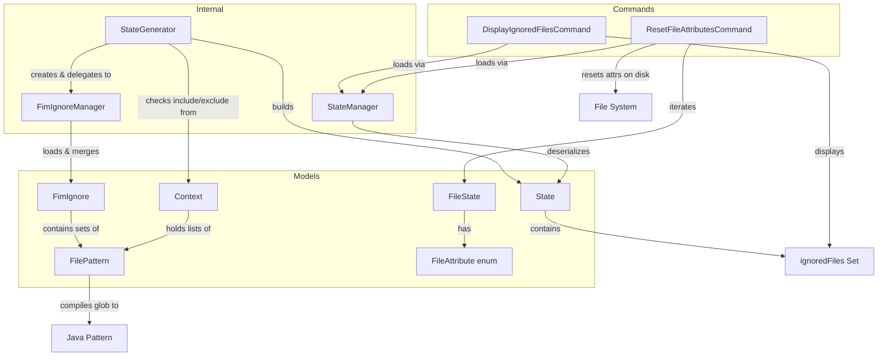

# Design Document: File Ignore System

## Overview

The File Ignore System provides mechanisms for excluding files and directories from FIM's integrity tracking. It operates at two levels: `.fimignore` files placed in repository directories define persistent, hierarchical ignore rules (analogous to `.gitignore`), while CLI `--include`/`--exclude` options provide per-invocation filtering. The system integrates into the `StateGenerator` scan loop, evaluating each encountered file/directory against a merged set of patterns before deciding whether to hash or skip it.

Key design characteristics:
- Hierarchical pattern inheritance: patterns prefixed with `**/` propagate recursively to all subdirectories
- A fixed set of always-ignored directories (`.fim`, `.git`, `.svn`, `.cvs`) is hardcoded
- Ignored file paths are persisted in each `State` for later retrieval by the `display-ignored` command
- Glob-style patterns are compiled to Java regex for matching, with fallback to exact string equality on compilation failure
- The `ResetFileAttributesCommand` operates on the stored `State` to restore file permissions, timestamps, and SELinux labels

## Architecture

The file ignore system spans three architectural layers: model objects, an internal manager, and command-level consumers.



The flow during state generation:
1. `StateGenerator` creates a `FimIgnoreManager` in its constructor
2. Before scanning, `FimIgnoreManager.loadInitialFimIgnore()` loads the root `.fimignore` and merges parent directory patterns (for subdirectory invocations)
3. For each directory entered, `loadLocalIgnore()` loads that directory's `.fimignore` and merges inherited `allDirectories` patterns from the parent
4. For each file/directory encountered, `isIgnored()` checks against hardcoded directories, then `allDirectories` patterns, then `local` patterns
5. Ignored items are recorded via `ignoreThisFiles()` into the `ignoredFiles` set
6. Non-ignored regular files are further filtered by `Context.includePatterns` and `Context.excludePatterns` before enqueuing for hashing
7. After scanning completes, the `ignoredFiles` set is stored in the `State` object

## Components and Interfaces

### FilePattern

Location: `org.fim.model.FilePattern`

Converts a glob-style pattern string into a compiled `java.util.regex.Pattern` for matching file names.

```java
public class FilePattern {
    private String fileName;        // Original pattern string (trimmed)
    private Pattern compiled;       // Compiled regex, null if compilation failed

    public FilePattern(String fileNamePattern);  // Compiles glob to regex
    public boolean match(String fileNameToMatch); // Tests a filename
    public static boolean matchPatterns(String fileName, List<FilePattern> patterns, boolean defaultValue);
    public FilePattern clone();
}
```

Glob-to-regex conversion rules:
1. Escape regex special characters: `\`, `^`, `$`, `{`, `}`, `[`, `]`, `(`, `)`, `.`, `|`, `?`
2. Collapse multiple consecutive `*` into a single `*`
3. Replace `*` with `.*`
4. Anchor with `^` and `$`

If `PatternSyntaxException` occurs, `compiled` is set to `null` and `match()` falls back to `String.equals()`.

`equals()` and `hashCode()` use null-safe access for the `compiled` field (converting to string via `compiled != null ? compiled.toString() : null`), preventing `NullPointerException` when the pattern failed to compile.

The static `matchPatterns()` method iterates a list of patterns, returning `true` if any match, `false` if none match, or `defaultValue` if the list is `null`.

### FimIgnore

Location: `org.fim.model.FimIgnore`

Holds two sets of `FilePattern` instances representing ignore rules for a single directory scope.

```java
public class FimIgnore {
    private final Set<FilePattern> filesToIgnoreLocally;          // Patterns for this directory only
    private final Set<FilePattern> filesToIgnoreInAllDirectories; // Patterns inherited recursively
}
```

Both sets are `HashSet<FilePattern>`, relying on `FilePattern.equals()`/`hashCode()` to prevent duplicates.

### FimIgnoreManager

Location: `org.fim.internal.FimIgnoreManager`

Central component that loads `.fimignore` files, merges pattern hierarchies, evaluates ignore decisions, and tracks ignored file paths.

```java
public class FimIgnoreManager {
    public static final String DOT_FIM_IGNORE = ".fimignore";
    public static final String ALL_DIRECTORIES_PATTERN = "**/";
    public static final Set<String> IGNORED_DIRECTORIES = {".fim", ".git", ".svn", ".cvs"};

    public FimIgnoreManager(Context context);
    public FimIgnore loadInitialFimIgnore();                          // Root + parent traversal
    public FimIgnore loadLocalIgnore(Path directory, FimIgnore parent); // Per-directory load + merge
    protected FimIgnore loadFimIgnore(Path directory);                 // Parse a single .fimignore
    public boolean isIgnored(String fileName, BasicFileAttributes attrs, FimIgnore fimIgnore);
    public void ignoreThisFiles(Path file, BasicFileAttributes attrs); // Record to ignoredFiles set
    public Set<String> getIgnoredFiles();
}
```

Key behaviors:
- `loadInitialFimIgnore()`: loads the `.fimignore` from `user.dir`, then traverses from `currentDirectory` up to `repositoryRootDir`, merging all `allDirectories` patterns
- `loadLocalIgnore()`: loads a directory's `.fimignore` and inherits the parent's `allDirectories` patterns
- `isIgnored()`: checks hardcoded `IGNORED_DIRECTORIES` first (for directories), then `allDirectories` patterns, then `local` patterns
- `ignoreThisFiles()`: computes the relative path from repository root, appends `/` for directories, and adds to the `ignoredFiles` set

#### The repository root has to contain the scanned directory

Both `loadInitialFimIgnore()` and `ignoreThisFiles()` are written against `context.getRepositoryRootDir()`, and the manager captures that root once in its constructor. The upward traversal recognises where to stop by comparing each directory to it:

```java
Path directory = context.getAbsoluteCurrentDirectory();
while (!directory.equals(context.getRepositoryRootDir())) {
    directory = directory.getParent();
    if (directory == null) {
        break;
    }
    ...
}
```

A root that does not sit above the current directory is therefore never matched, and the loop exits only on `getParent() == null`: it walks to the top of the filesystem, merging a `.fimignore` from every directory on the way. `ignoreThisFiles()` degrades in the same situation, its prefix-stripping leaving absolute paths in `ignoredFiles` because the root is not a prefix of the scanned paths.

Callers scanning one tree while holding a State from another must therefore give the scan its own `Context`. `RemoveDuplicatesCommand` is the case that matters: with `-M` the current directory is required to sit *outside* the master repository, so pointing the root at the master guarantees the failure above. See the Duplicate Detection spec, Requirements 10.9 to 10.11.

### StateGenerator (ignore integration)

Location: `org.fim.internal.StateGenerator`

The `scanFileTree()` method integrates the ignore system:

```java
private void scanFileTree(BlockingDeque<Path> queue, Path directory, FimIgnore parentFimIgnore) {
    FimIgnore fimIgnore = fimIgnoreManager.loadLocalIgnore(directory, parentFimIgnore);
    for (Path file : directoryStream) {
        if (fimIgnoreManager.isIgnored(fileName, attributes, fimIgnore)) {
            fimIgnoreManager.ignoreThisFiles(file, attributes);
        } else if (attributes.isRegularFile()) {
            if (FilePattern.matchPatterns(fileName, context.getIncludePatterns(), true) &&
                !FilePattern.matchPatterns(fileName, context.getExcludePatterns(), false)) {
                enqueueFile(queue, file);
            }
        } else if (attributes.isDirectory()) {
            scanFileTree(queue, file, fimIgnore);  // Recurse with current fimIgnore as parent
        }
    }
}
```

After scanning, `state.setIgnoredFiles(fimIgnoreManager.getIgnoredFiles())` persists the set.

### DisplayIgnoredFilesCommand

Location: `org.fim.command.DisplayIgnoredFilesCommand`

Command name: `display-ignored` (alias: `dign`)

Loads the last committed `State` via `StateManager`, retrieves `state.getIgnoredFiles()`, and prints each entry. Displays "No files or directories ignored into this State" when the set is empty/null. Shows state metadata (number, timestamp, file count, content length, comment). The file count and content length come from `State.getFileCount()` and `State.getFilesContentLength()`, which exclude the entries a commit recorded as deleted — see the State Management spec, *Why deleted entries are excluded from the counts*.

### ResetFileAttributesCommand

Location: `org.fim.command.ResetFileAttributesCommand`

Command name: `reset-file-attrs` (alias: `rfa`)

Loads the last committed `State`, prompts for confirmation, then iterates each `FileState`:
- On POSIX: compares/resets `PosixFilePermissions`
- On Windows: compares/resets `DosFilePermissions`
- Compares/resets creation time and last-modified time
- If SELinux is enabled: compares/resets SELinux labels
- Skips files that no longer exist on disk
- Logs errors per-file and continues
- Supports subdirectory filtering via `state.filterDirectory()`

### Context (pattern storage)

Location: `org.fim.model.Context`

Stores `List<FilePattern> includePatterns` and `List<FilePattern> excludePatterns` parsed from CLI `--include` and `--exclude` options. Both default to `null` (meaning "include all" and "exclude none" respectively).

## Data Models

### FilePattern

| Field | Type | Description |
|-------|------|-------------|
| `fileName` | `String` | Original glob pattern string, trimmed |
| `compiled` | `java.util.regex.Pattern` | Compiled regex, or `null` on compilation failure |

### FimIgnore

| Field | Type | Description |
|-------|------|-------------|
| `filesToIgnoreLocally` | `Set<FilePattern>` | Patterns applying only to the containing directory |
| `filesToIgnoreInAllDirectories` | `Set<FilePattern>` | Patterns applying recursively to all subdirectories |

### State (ignore-related fields)

| Field | Type | Description |
|-------|------|-------------|
| `ignoredFiles` | `Set<String>` | Relative paths of ignored files/directories (directories suffixed with `/`) |

The `ignoredFiles` set is included in:
- `equals()` / `hashCode()` comparisons
- `hashObject()` for state integrity hashing
- JSON serialization/deserialization (GZIP-compressed)
- `clone()` operations

### FileAttribute (enum)

| Value | Description |
|-------|-------------|
| `DosFilePermissions` | Windows file permission string |
| `PosixFilePermissions` | POSIX permission string (e.g., `rwxr-xr-x`) |
| `SELinuxLabel` | SELinux security context label |

### FileState (attribute-related fields)

| Field | Type | Description |
|-------|------|-------------|
| `fileName` | `String` | Relative file path from repository root |
| `fileLength` | `long` | File size in bytes |
| `fileTime` | `FileTime` | Creation time and last-modified time |
| `fileHash` | `FileHash` | Cryptographic hashes |
| `fileAttributes` | `Map<String, String>` | Key-value pairs keyed by `FileAttribute.name()` |


## Correctness Properties

*A property is a characteristic or behavior that should hold true across all valid executions of a system — essentially, a formal statement about what the system should do. Properties serve as the bridge between human-readable specifications and machine-verifiable correctness guarantees.*

### Property 1: Fimignore pattern classification

*For any* `.fimignore` file content consisting of lines, each line prefixed with `**/` should result in a `FilePattern` (with the prefix stripped) in the `filesToIgnoreInAllDirectories` set, and each line without the prefix should result in a `FilePattern` in the `filesToIgnoreLocally` set.

**Validates: Requirements 1.2, 1.3**

### Property 2: All-directories pattern inheritance via merge

*For any* parent `FimIgnore` with a non-empty `filesToIgnoreInAllDirectories` set, when `loadLocalIgnore()` is called for a child directory, the resulting child `FimIgnore` shall contain all of the parent's `filesToIgnoreInAllDirectories` patterns in its own `filesToIgnoreInAllDirectories` set.

**Validates: Requirements 1.4**

### Property 3: Hardcoded directories are always ignored

*For any* directory name in the set `{".fim", ".git", ".svn", ".cvs"}` and any `FimIgnore` instance (including an empty one), `isIgnored()` called with directory attributes shall return `true`.

**Validates: Requirements 2.1**

### Property 4: Pattern-based ignore evaluation

*For any* file name and any `FimIgnore` instance where at least one `FilePattern` in either the `filesToIgnoreInAllDirectories` set or the `filesToIgnoreLocally` set matches that file name, `isIgnored()` shall return `true`.

**Validates: Requirements 2.3**

### Property 5: Ignored directory paths have trailing slash

*For any* ignored path recorded via `ignoreThisFiles()` where the `BasicFileAttributes` indicate a directory, the recorded string in the `ignoredFiles` set shall end with `/`. For regular files, the recorded string shall not end with `/`.

**Validates: Requirements 2.4**

### Property 6: Glob-to-regex compilation correctness

*For any* glob pattern string, the compiled `FilePattern` regex shall: (a) have all regex special characters (`\`, `^`, `$`, `{`, `}`, `[`, `]`, `(`, `)`, `.`, `|`, `?`) escaped, (b) have multiple consecutive `*` collapsed to a single `.*`, and (c) be anchored with `^` at the start and `$` at the end.

**Validates: Requirements 3.1, 3.2, 3.3**

### Property 7: FilePattern identity matching

*For any* valid glob pattern string that does not contain wildcard characters (`*`), constructing a `FilePattern` from that string and calling `match()` with the same string shall return `true`.

**Validates: Requirements 3.6**

### Property 8: Include/exclude filtering logic

*For any* file name, list of include patterns, and list of exclude patterns, the file shall be accepted for hashing if and only if it matches at least one include pattern AND does not match any exclude pattern. When include patterns are `null`, all files are included by default. When exclude patterns are `null`, no files are excluded by default.

**Validates: Requirements 4.3, 4.4, 4.5, 4.6, 4.7**

### Property 9: Subdirectory state filtering

*For any* `State` containing file states and any subdirectory path within the repository, calling `filterDirectory()` with `keepFilesInside=true` shall return a state containing only file states whose `fileName` starts with the relative subdirectory prefix.

**Validates: Requirements 6.8**

### Property 10: State ignoredFiles round-trip

*For any* `State` object containing a non-empty `ignoredFiles` set, saving the state to a GZIP-compressed JSON file and loading it back shall produce a state with an equivalent `ignoredFiles` set.

**Validates: Requirements 7.2, 7.3, 7.4**

## Error Handling

| Scenario | Component | Behavior |
|----------|-----------|----------|
| `.fimignore` file unreadable (I/O error) | `FimIgnoreManager.loadFimIgnore()` | Logs error with file path and message, returns empty `FimIgnore` |
| Invalid regex from glob pattern | `FilePattern` constructor | Sets `compiled` to `null`, `match()` falls back to `String.equals()` |
| No State exists in repository | `DisplayIgnoredFilesCommand` | Checks `getLastStateNumber() == -1`, logs "No State found", returns `null` |
| No State exists in repository | `ResetFileAttributesCommand` | `StateManager.loadLastState()` throws `IllegalStateException` |
| File no longer exists on disk during attribute reset | `ResetFileAttributesCommand` | `Files.exists(file)` check skips the file silently |
| Error resetting attributes for a specific file | `ResetFileAttributesCommand` | Catches `Exception`, logs `ex.getMessage()`, continues to next file |
| Directory scan I/O error | `StateGenerator.scanFileTree()` | Catches `IOException`, logs "Skipping - Error scanning directory", continues |
| Corrupted state file | `State.loadFromGZipFile()` | Throws `CorruptedStateException` if hash integrity check fails |

## Testing Strategy

### Unit Tests

Unit tests should cover specific examples and edge cases:

- Loading a `.fimignore` file with mixed `**/` and local patterns and verifying correct classification
- Verifying that hardcoded directories (`.fim`, `.git`, `.svn`, `.cvs`) are always ignored
- Testing `FilePattern` with special regex characters (e.g., `$Data[1]|2(3)*`)
- Testing `FilePattern` fallback to `String.equals()` when regex compilation fails
- Testing `DisplayIgnoredFilesCommand` output with empty/null ignored files set
- Testing `ResetFileAttributesCommand` skipping non-existent files
- Testing `FimIgnoreManager` behavior when `.fimignore` file has I/O errors
- Testing `FimIgnore` duplicate prevention via `HashSet`
- Testing `matchPatterns` with `null` pattern lists returning default values

### Property-Based Tests

Correctness properties are checked with JUnit 5 `@ParameterizedTest`; the project deliberately has no
property-based testing library. Small input domains are enumerated exhaustively; wider ones are sampled
from the fixed seed in `org.fim.tooling.RandomInputs` with boundary values listed explicitly. Each test
must reference its design document property with a tag comment.

Each correctness property (Properties 1–10) must be implemented as a single parameterized test:

- **Feature: file-ignore-system, Property 1: Fimignore pattern classification** — Generate random lines with and without `**/` prefix, write to `.fimignore`, load, verify classification
- **Feature: file-ignore-system, Property 2: All-directories pattern inheritance** — Generate random parent patterns, call `loadLocalIgnore()`, verify child contains all parent allDirectories patterns
- **Feature: file-ignore-system, Property 3: Hardcoded directories always ignored** — Generate random `FimIgnore` instances, verify `isIgnored()` returns true for each hardcoded directory name
- **Feature: file-ignore-system, Property 4: Pattern-based ignore evaluation** — Generate random file names and matching patterns, verify `isIgnored()` returns true
- **Feature: file-ignore-system, Property 5: Ignored directory paths have trailing slash** — Generate random paths with directory/file attributes, verify trailing `/` presence/absence
- **Feature: file-ignore-system, Property 6: Glob-to-regex compilation** — Generate random glob strings, verify compiled regex has correct escaping, collapsing, and anchoring
- **Feature: file-ignore-system, Property 7: FilePattern identity matching** — Generate random strings without `*`, verify `FilePattern(s).match(s)` is true
- **Feature: file-ignore-system, Property 8: Include/exclude filtering logic** — Generate random file names and pattern lists, verify `matchPatterns` composition matches expected boolean logic
- **Feature: file-ignore-system, Property 9: Subdirectory state filtering** — Generate random states with file paths and subdirectory prefixes, verify `filterDirectory()` output
- **Feature: file-ignore-system, Property 10: State ignoredFiles round-trip** — Generate random `State` objects with ignored files, save to temp GZIP file, load back, verify equality
