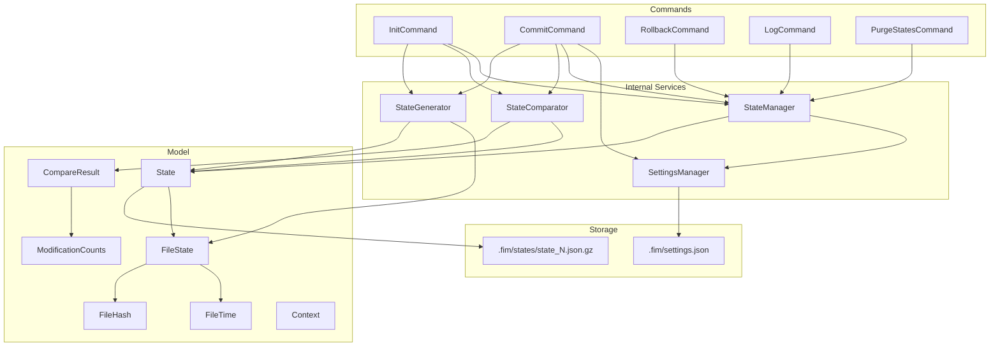

# Design Document: State Management

## Overview

This design documents the existing State Management subsystem of FIM (File Integrity Manager). State Management is the core lifecycle engine that creates, persists, compares, rolls back, logs, and purges file integrity snapshots called "States." Each State is a GZIP-compressed JSON file containing cryptographic hashes and metadata for every tracked file in a repository's file tree.

The subsystem is implemented across two layers:
- **Command layer** (`org.fim.command`): User-facing commands (`init`, `commit`, `rollback`, `log`, `purge-states`) that orchestrate the workflow.
- **Internal layer** (`org.fim.internal`): Core services (`StateManager`, `StateGenerator`, `StateComparator`) that handle persistence, scanning, and diffing.

## Architecture



### Key Design Decisions

1. **GZIP + JSON for State persistence**: States are serialized via Jackson ObjectMapper to JSON, then GZIP-compressed. This balances human-readability (JSON) with storage efficiency (GZIP).
2. **Sequential numbering with settings tracking**: State files are named `state_<N>.json.gz` with a monotonically incrementing integer. The last state number is tracked in `settings.json` with a self-healing mechanism that re-scans disk if the number is desynchronized.
3. **SHA-512 integrity hash**: Each State computes a `stateHash` over all its content fields using Guava's `Hashing.sha512()`, encoded via Ascii85. This hash is embedded in the file and verified on load.
4. **Null last-state for init**: `StateComparator` accepts a `null` last state, treating all files as "added" during initialization.
5. **Hash mode adjustment on load**: `StateManager.loadState()` adjusts `FileHash` fields based on the current `Context.hashMode`, replacing irrelevant hash components with `NO_HASH` to enable comparison across different hash modes.
6. **Subdirectory commit consolidation**: When committing from a subdirectory, `CommitCommand` merges the subdirectory scan with files from the last state that are outside the subdirectory, producing a complete consolidated state. The consolidated state's `ModificationCounts` is rebuilt from its own `FileState` entries rather than reused from the subdirectory comparison.

7. **Deleted entries are stored but not counted**: A commit appends the `FileState` entries it deleted to the State it saves, so that `fim log` can report what that commit removed. They are excluded from `fileCount` and `filesContentLength`, since they stand for files that no longer exist. See *Why deleted entries are excluded from the counts* below.

8. **Writability decided by trying, not by asking**: The repository checks in `Fim` consult the permissions the filesystem reports first, then fall back to a real write attempt. `Files.isWritable()` is not conclusive on a network share, where the reported ownership and mode bits often describe the mount rather than the account in use, so a writable CIFS/SMB directory is reported read-only and Fim refused to create a repository on it. `FileUtil.isWritableDirectory()` probes by creating and deleting a file; `FileUtil.isWritableFile()` opens an existing file for writing without truncating it, and judges a file that does not exist yet by its directory, which is the case of a repository whose settings file has not been written.

9. **`.fim` created only after the scan**: `InitCommand` generates the State, compares it, and only then calls `createRepository()`. An interrupted scan therefore leaves nothing behind, and `init` can be re-run. It does not resume: the scan restarts from the beginning.

## Components and Interfaces

### StateManager (`org.fim.internal.StateManager`)

Responsible for all State file I/O and numbering.

| Method | Description |
|---|---|
| `createNewState(State)` | Increments the last state number, saves the state to a new GZIP file, updates settings. |
| `loadLastState()` | Loads the most recent state file with full validation. |
| `loadState(int, boolean)` | Loads a specific state by number. When `loadFullState=true`, verifies the state hash and adjusts hashes per hash mode. |
| `getStateFile(int)` | Returns the `Path` for `state_<N>.json.gz`. |
| `getLastStateNumber()` | Reads the last state number from settings, with self-healing if desynchronized with actual files on disk. |
| `saveLastStateNumber(int)` | Persists the last state number to `settings.json`. |

### StateGenerator (`org.fim.internal.StateGenerator`)

Scans the file tree and produces a new `State` object.

| Method | Description |
|---|---|
| `generateState(String, Path, Path)` | Recursively scans `dirToScan` relative to `rootDir`, hashes all regular files using a thread pool, and returns a populated `State` with the given comment. |

Key behaviors:
- Uses a `BlockingDeque<Path>` with capacity 500 to feed files to `FileHasher` threads.
- Supports dynamic scaling of thread count.
- Respects `.fimignore` files and include/exclude patterns from `Context`.
- Sorts resulting `FileState` entries by file name.

### StateComparator (`org.fim.internal.StateComparator`)

Compares two `State` objects and produces a `CompareResult`.

| Method | Description |
|---|---|
| `compare()` | Executes the full comparison pipeline: find added/modified, match by filename, search for renames/duplicates/copies, find deleted. Returns a sorted `CompareResult`. |
| `resetFileStates(List<FileState>)` | Static utility that clears modification markers and removes deleted entries from a file state list. |

Comparison pipeline:
1. Build a multimap of previous file states keyed by `FileHash`.
2. Use `longHashCode()` to quickly identify unchanged files.
3. Match remaining files by filename to detect content/date/attribute modifications.
4. Match by hash to detect renames, copies, and duplicates.
5. Remaining unmatched previous files are marked as deleted.

### SettingsManager (`org.fim.internal.SettingsManager`)

Manages the `.fim/settings.json` file using Gson serialization.

| Method | Description |
|---|---|
| `getGlobalHashMode()` / `setGlobalHashMode(HashMode)` | Read/write the repository-wide hash mode. |
| `getLastStateNumber()` / `setLastStateNumber(int)` | Read/write the last committed state number. |
| `save()` | Persists settings to disk. |

### Command Classes

All commands extend `AbstractCommand` which provides:
- `confirmAction(Context, String)`: Interactive y/n/A confirmation prompt. Skipped when `context.isAlwaysYes()`.
- `adjustThreadCount(Context)`: Forces thread count to 1 when hash mode is `dontHash`.
- `checkHashMode(Context, Option...)`: Validates and adjusts hash mode against the global setting.

| Command | Constraint | Description |
|---|---|---|
| `InitCommand` | `MUST_NOT_EXIST` | Generates the first state, then creates `.fim/states/` and saves it as `state_1.json.gz`. The directory is created only after the scan, so an interrupted scan leaves no repository behind. |
| `CommitCommand` | `MUST_EXIST` | Generates new state, compares with last, persists if changes found. Handles subdirectory commits and hash mode mismatches. |
| `RollbackCommand` | `MUST_EXIST` | Deletes the last state file and decrements the state number. Requires confirmation. |
| `LogCommand` | `MUST_EXIST` | Iterates all states 1..N, loads each without full validation, displays header and modification summary. |
| `PurgeStatesCommand` | `MUST_EXIST` | Deletes all state files except the most recent one. Renumbers the surviving last state file to `state_1.json.gz` and updates the last state number to 1. Requires confirmation. |

## Data Models

### State (`org.fim.model.State`)

The top-level snapshot object.

| Field | Type | Description |
|---|---|---|
| `stateHash` | `String` | SHA-512 hash of the entire state content, Ascii85-encoded. Used for integrity verification. |
| `modelVersion` | `String` | Schema version (currently `"5"`). |
| `timestamp` | `long` | Creation time in milliseconds since epoch. |
| `comment` | `String` | User-provided or default comment. |
| `fileCount` | `int` | Number of tracked files. Counts only the entries not marked `deleted`, and is recomputed from `fileStates` on every read as well as before save. |
| `filesContentLength` | `long` | Sum of the sizes of the entries not marked `deleted`. Recomputed on every read as well as before save. |
| `hashMode` | `HashMode` | The hashing strategy used (`hashAll`, `hashSmallBlock`, `hashMediumBlock`, `dontHash`). |
| `commitDetails` | `CommitDetails` | Metadata about the commit (hash mode used for status, subdirectory info). |
| `modificationCounts` | `ModificationCounts` | Summary counts of each modification type. Not included in `equals()`/`hashCode()`/`hashObject()`. |
| `ignoredFiles` | `Set<String>` | Files/directories excluded by `.fimignore`. |
| `fileStates` | `List<FileState>` | The per-file metadata records. |

Key methods:
- `saveToGZipFile(Path)`: Sorts file states, updates counts, computes `stateHash`, writes GZIP JSON.
- `loadFromGZipFile(Path, boolean)`: Reads GZIP JSON, optionally verifies integrity.
- `updateFileCount()` / `updateFilesContentLength()`: Recompute the two totals over `presentFileStates()`.
- `presentFileStates()`: The `FileState` entries this State's tree actually holds, that is every entry whose `modification` is not `deleted`. Yields an empty stream when `fileStates` is `null`.
- `hashState()`: Computes SHA-512 over all content fields using Guava `Hasher`. `ignoredFiles` is iterated **as-is** and must never be reordered here.
- `toCanonicalIgnoredFiles(Set)`: Used by `setIgnoredFiles()` and `clone()`. Copies the ignored files into a `HashSet` grown from the default capacity, which is the representation the hash depends on.
- `filterDirectory(Path, Path, boolean)`: Returns a clone with file states filtered by subdirectory membership.
- `clone()`: Deep copy of all fields, with `ignoredFiles` passed through `toCanonicalIgnoredFiles()`.

#### Why the ignored files ordering must not be normalized

`hashState()` serves two purposes: producing the hash embedded on save, and recomputing it on load to verify integrity. Verification only succeeds if both computations hash the same sequence, so the load path constrains what the save path may do.

Jackson deserializes `ignoredFiles` into a `HashSet`. The order a State is read back in is therefore the `HashSet` iteration order for its elements, **not** the order the JSON array was written in. This is what makes the existing scheme work at all: `HashSet` ordering is derived from the elements rather than from insertion order, so a writer holding a `HashSet` and a reader rebuilding one arrive at the same sequence.

Sorting inside `hashState()` (for instance by iterating a `TreeSet`) hashes a different sequence than every previously written State file was hashed with. Every such State holding two or more ignored files then fails `checkIntegrity()` and is reported as `The content of the State file #N have been modified and may be corrupted`. The break is bidirectional: States written by the newer code equally fail to load under an older Fim. Normalizing the order only on save does not help either, because the reader still derives `HashSet` order and so would not reproduce the sorted hash.

The determinism concern that motivates sorting is real but is addressed by pinning the representation instead. `toCanonicalIgnoredFiles()` guarantees the field is always a `HashSet`, so handing the State a `LinkedHashSet` or a `TreeSet` no longer drags the hash along with that set's ordering. Elements are inserted one at a time rather than through `new HashSet<>(Collection)`, because that constructor pre-sizes its table from the source size and at some sizes yields a larger table, and therefore a different iteration order, than the incrementally grown set the reader builds.

`CURRENT_MODEL_VERSION` stays at `5` because neither the file format nor the hash computation changed. Switching to a sorted or otherwise reordered hash would be a format change and would require bumping it, which routes older files to the model-version branch of `loadFromGZipFile()` instead of failing their integrity check. That is a heavier change than it looks: `StateComparator.init()` discards a last State whose model version differs, so the first comparison after such a bump reports every file as added.

#### Why deleted entries are excluded from the counts

`CommitCommand.commitModifications()` appends the deleted `FileState` entries to the State it is about to save, which is what lets `fim log` list the deletions of a past commit. Those entries describe files that are gone, so counting them as ordinary files made the State that deleted them report them as still present and still occupying space. The freed space then appeared only in the *following* State, once `StateComparator.resetFileStates()` dropped the deleted entries while loading.

`updateFileCount()` and `updateFilesContentLength()` therefore skip entries marked `deleted`. Two consequences are worth spelling out:

- **The correction is retroactive.** Both getters recompute from `fileStates` on every call rather than returning the value read from the file, so States written before this rule report corrected numbers too. Nothing has to be rewritten or migrated.
- **The integrity check is untouched, so no model version bump is needed.** `hashObject()` consumes the `fileCount` and `filesContentLength` *fields*, and on load those hold whatever was deserialized from JSON. `checkIntegrity()` runs immediately after deserialization, before any getter is called, so it still hashes exactly the values the file was written with. This is the opposite situation to the ignored files ordering above, where the hash input itself would have changed.

Both `fim log` and `fim display-ignored` read these two values, so both report the corrected figures.

### FileState (`org.fim.model.FileState`)

Per-file metadata record within a State.

| Field | Type | Description |
|---|---|---|
| `fileName` | `String` | Relative path from repository root. Interned for memory efficiency. |
| `fileLength` | `long` | File size in bytes. |
| `fileTime` | `FileTime` | Creation time and last modified time. |
| `modification` | `Modification` | The type of change detected (added, deleted, contentModified, etc.). |
| `fileHash` | `FileHash` | Cryptographic hashes at three granularities. |
| `fileAttributes` | `Map<String, String>` | File system attributes (POSIX permissions, DOS permissions, SELinux labels). |
| `previousFileState` | `FileState` | Reference to the previous version of this file (for displaying diffs). |

Transient fields (not serialized): `newFileHash`, `originalFileHash`, `toRemove`.

### FileHash (`org.fim.model.FileHash`)

Three-level hash structure for flexible comparison.

| Field | Type | Description |
|---|---|---|
| `smallBlockHash` | `String` | Hash of the first small block of the file. |
| `mediumBlockHash` | `String` | Hash of the first medium block. |
| `fullHash` | `String` | Hash of the entire file content. |

All strings are interned. Implements `Comparable<FileHash>` for sorting.

### ModificationCounts (`org.fim.model.ModificationCounts`)

Summary of detected changes.

| Field | Type |
|---|---|
| `added` | `int` |
| `copied` | `int` |
| `duplicated` | `int` |
| `dateModified` | `int` |
| `contentModified` | `int` |
| `attributesModified` | `int` |
| `renamed` | `int` |
| `deleted` | `int` |
| `corrupted` | `int` |

Can be constructed from a `List<FileState>` by counting each `Modification` type. Note: `CompareResult.getModificationCounts()` does not currently populate the `corrupted` field; only `modifiedCount()` includes corrupted entries in its total.

### Context (`org.fim.model.Context`)

Runtime execution context carrying all parameters.

Key fields: `currentDirectory`, `repositoryRootDir`, `hashMode`, `comment`, `threadCount`, `alwaysYes`, `purgeStates`, `invokedFromSubDirectory`, `ignored`, `includePatterns`, `excludePatterns`.

Derived paths:
- `getRepositoryDotFimDir()` → `<repositoryRootDir>/.fim`
- `getRepositoryStatesDir()` → `<repositoryRootDir>/.fim/states`

### CompareResult (`org.fim.model.CompareResult`)

Result of comparing two states, containing categorized lists of `Difference` objects.

Categories: `added`, `copied`, `duplicated`, `dateModified`, `contentModified`, `attributesModified`, `renamed`, `deleted`, `corrupted`.

Provides `somethingModified()`, `modifiedCount()`, `getModificationCounts()`, and `displayChanges()`.


## Correctness Properties

*A property is a characteristic or behavior that should hold true across all valid executions of a system — essentially, a formal statement about what the system should do. Properties serve as the bridge between human-readable specifications and machine-verifiable correctness guarantees.*

### Property 1: State serialization round-trip

*For any* valid State object containing arbitrary FileState entries with valid fileNames, fileLengths, fileTimes, fileHashes, and fileAttributes, saving the State to a GZIP-compressed JSON file and then loading it back should produce a State object that is equal to the original.

**Validates: Requirements 7.1, 7.2**

### Property 2: State hash integrity verification

*For any* valid State object, the `stateHash` computed during `saveToGZipFile()` should equal the hash recomputed by `hashState()` on the loaded State. That is, `save` then `load` with full validation should succeed without throwing `CorruptedStateException`.

**Validates: Requirements 3.3, 3.7**

### Property 3: Corrupted state detection

*For any* valid State file on disk, if any byte of the JSON content (after decompression) is modified, loading the State with full validation enabled should raise a `CorruptedStateException`.

**Validates: Requirements 3.8**

### Property 4: FileState sort invariant on save

*For any* State object with an arbitrary list of FileState entries, after calling `saveToGZipFile()`, the persisted file states should be sorted in ascending order by `fileName`.

**Validates: Requirements 3.2**

### Property 5: State number monotonic increment

*For any* sequence of N successful `createNewState()` calls on a StateManager, the last state number should equal the initial state number plus N, and state files `state_1.json.gz` through `state_(initial+N).json.gz` should all exist.

**Validates: Requirements 2.3, 3.10**

### Property 6: Comment preservation

*For any* non-null comment string, when a State is created with that comment (via init or commit), the resulting persisted State's `comment` field should be equal to the provided string.

**Validates: Requirements 1.3, 2.5**

### Property 7: No-op commit when unchanged

*For any* repository where no files have been added, deleted, or modified since the last committed State, executing a commit should not create a new State file, and the last state number should remain unchanged.

**Validates: Requirements 2.4**

### Property 8: Subdirectory commit consolidation

*For any* repository with files in multiple subdirectories, when a commit is invoked from a subdirectory, the resulting consolidated State should contain all FileState entries from the scanned subdirectory plus all FileState entries from the previous State that are outside the subdirectory.

**Validates: Requirements 2.11**

### Property 9: ModificationCounts consistency

*For any* two States where the CompareResult detects modifications, the `ModificationCounts` stored in the committed State should have counts that match the sizes of the corresponding difference lists (added, deleted, contentModified, dateModified, attributesModified, renamed, duplicated) in the CompareResult. Exception: the `corrupted` field is NOT populated by `getModificationCounts()` — it remains at its default value (0), even when `cr.getCorrupted()` is non-empty.

**Validates: Requirements 2.14**

### Property 10: Rollback decrements state count

*For any* repository with N states (N > 1), after a confirmed rollback, the last state number should be N-1, the file `state_N.json.gz` should no longer exist, and `state_(N-1).json.gz` should still exist.

**Validates: Requirements 4.3**

### Property 11: Purge retains only last state

*For any* repository with N states (N > 1), after a confirmed purge, only `state_1.json.gz` should remain in the States_Directory (the last state is renumbered to position 1), all files `state_1.json.gz` through `state_(N-1).json.gz` from before the purge should be deleted, and the last state number should be set to 1.

**Validates: Requirements 6.1, 6.3**

### Property 12: Log entry completeness

*For any* State loaded from a repository, the LogEntry constructed from it should contain the state number, a non-null timestamp, the file count matching the State's file count, the files content length, the comment, and non-null ModificationCounts.

**Validates: Requirements 5.1, 5.2, 5.3, 5.4**

### Property 13: State number self-healing

*For any* repository where the `lastStateNumber` in `settings.json` does not match the actual highest-numbered state file on disk, calling `getLastStateNumber()` should return the actual highest state number derived from the files on disk and correct the settings.

**Validates: Requirements 3.11**

### Property 14: State field completeness on creation

*For any* newly created State (via init or commit), the State should have a non-null `modelVersion` equal to `State.CURRENT_MODEL_VERSION`, a positive `timestamp`, a `fileCount` equal to the number of its `fileStates` entries that are not marked `deleted`, a `filesContentLength` equal to the sum of `FileState.fileLength` over those same entries, a non-null `hashMode`, and a non-null `stateHash`. For a State with no deleted entries — which is every State produced by `init` — those two values are simply the size and the total length of the whole list.

**Validates: Requirements 1.11, 3.12, 3.13**

## Error Handling

### Command-Level Errors

| Error Condition | Handler | Behavior |
|---|---|---|
| Init on existing repository | `Fim.validateNewRepository()` (via `FimReposConstraint.MUST_NOT_EXIST`) | Aborts before execution, logging "Fim repository already exist" and throwing `BadFimUsageException`. |
| Repository root not writable | `Fim.validateNewRepository()` | Logs "Not allowed to create the '&lt;dir&gt;' directory that holds the Fim repository" and throws `RepositoryException`. Decided by `FileUtil.isWritableDirectory()`, which falls back to a real write probe rather than trusting the reported permissions. |
| States directory or settings file not writable | `Fim.validateExistingRepository()` | Logs "Not allowed to modify States into the '&lt;dir&gt;' directory" or "Not allowed to save settings into the '&lt;dir&gt;' directory" and throws `RepositoryException`. The settings file is checked with `FileUtil.isWritableFile()`, which judges a not-yet-created file by its directory. |
| Commit with `dontHash` when global mode requires hashing | `CommitCommand` | Throws `BadFimUsageException` with message "Computing hash is mandatory". |
| Commit with ignored aspects | `CommitCommand` | Throws `BadFimUsageException` with message "Not allowed to ignore any aspect while committing". |
| Subdirectory commit with model version mismatch | `CommitCommand` | Throws `BadFimUsageException` with error message. |
| User declines confirmation prompt | `AbstractCommand.confirmAction()` | Returns `false`, command aborts gracefully without side effects. |
| No comment provided (init/commit) | `InitCommand`/`CommitCommand` | Throws `DontWantToContinueException` if user declines the confirmation prompt. |

### State I/O Errors

| Error Condition | Handler | Behavior |
|---|---|---|
| Cannot create `.fim` directory | `InitCommand.createRepository()` | Logs error, throws `RepositoryException`. |
| State file not found on load | `StateManager.loadState()` | Throws `IllegalStateException` with descriptive message. |
| Corrupted state hash on load | `State.loadFromGZipFile()` | Throws `CorruptedStateException`, caught by `StateManager` and re-thrown as `IllegalStateException`. |
| Settings file I/O error | `SettingsManager.load()`/`save()` | Throws `RepositoryException`. |
| State number desynchronized | `StateManager.getLastStateNumber()` | Self-heals by scanning disk, logs error, resets settings. |
| `null` State after JSON deserialization | `State.loadFromGZipFile()` | Throws `CorruptedStateException`. |

### StateGenerator Errors

| Error Condition | Handler | Behavior |
|---|---|---|
| Directory scan I/O error | `StateGenerator.scanFileTree()` | Logs error with directory path, skips the directory, continues scanning. |
| File enqueue timeout | `StateGenerator.enqueueFile()` | Logs error, file is skipped. |
| Thread interruption during hashing | `StateGenerator.waitAllFilesToBeHashed()` | Logs error, continues with partial results. |

## Testing Strategy

### Dual Testing Approach

Testing for the State Management feature uses both example-based unit tests and correctness property tests:

- **Unit tests**: Verify specific examples, edge cases, error conditions, and integration scenarios. Focus on concrete behaviors like "init creates `.fim/states/`", "rollback with one state displays 'No commit to rollback'", and error paths like corrupted state detection.
- **Correctness property tests**: Verify universal properties across a range of generated inputs, enumerated exhaustively where the input domain allows and sampled from a fixed seed otherwise. Focus on serialization round-trips, invariants (sort order, state numbering), and consistency guarantees (ModificationCounts matching CompareResult).

### Correctness Property Test Configuration

- **Framework**: JUnit 5 (Jupiter) `@ParameterizedTest` with AssertJ assertions. No separate property-based testing library is used; the project deliberately has no PBT dependency.
- **Input domains**: where a property's domain is small it is enumerated **exhaustively** (`IntStream.rangeClosed(..)`, `@EnumSource`, or a full cross product via `Stream<Arguments>`). Every value then runs on every build, and a failing case is already the minimal one. Domains too wide to enumerate (file sizes, generated names, composite objects) are sampled instead, with the boundary values listed explicitly.
- **Sampling**: `org.fim.tooling.RandomInputs` supplies the seeded generators. Its `SEED` is fixed, so a failing case reproduces on any machine. Nothing shrinks a failing input automatically, which is why boundaries are stated explicitly rather than discovered.
- **Preconditions**: a property that only holds above some input threshold narrows its provider range rather than using an assumption, so no case is silently skipped.
- **Tag format**: Each property test must include a comment referencing the design property:
  ```java
  // Feature: state-management, Property 1: State serialization round-trip
  ```
- Each correctness property (Properties 1–14) must be implemented by a single parameterized test.

### Test Categories

**Correctness property tests** (one per correctness property):
- State serialization round-trip (Property 1)
- State hash integrity verification (Property 2)
- Corrupted state detection (Property 3)
- FileState sort invariant (Property 4)
- State number monotonic increment (Property 5)
- Comment preservation (Property 6)
- No-op commit when unchanged (Property 7)
- Subdirectory commit consolidation (Property 8)
- ModificationCounts consistency (Property 9)
- Rollback decrements state count (Property 10)
- Purge retains only last state (Property 11)
- Log entry completeness (Property 12)
- State number self-healing (Property 13)
- State field completeness (Property 14)

**Unit tests** (specific examples and edge cases):
- Init creates `.fim` and `.fim/states` directories (Req 1.1)
- Init uses "Initial State" as default comment (Req 1.4)
- Init displays confirmation prompt when no comment (Req 1.5)
- Init fails when repository already exists (Req 1.6)
- Commit displays confirmation prompt when no comment (Req 2.6)
- Commit aborts when user declines prompt (Req 2.7)
- Commit aborts with `dontHash` when global mode requires hashing (Req 2.8)
- Commit aborts when aspects are ignored (Req 2.9)
- Commit with purge-states option triggers purge (Req 2.13)
- Load state with different model version logs warning (Req 3.9)
- Rollback with only one state displays "No commit to rollback" (Req 4.5)
- Log with no states displays "No State found" (Req 5.5)
- Log loads states without full validation (Req 5.6)
- Purge with only one state displays "No State to purge" (Req 6.5)
